## Summary

이 논문은 LVLM(Large Vision-Language Model)의 객체 환각(object hallucination)이 시각 어텐션(attention)이 부족해서 생긴다는 통념을 반박한다. 저자들은 실제 객체와 환각 객체가 중후반 레이어에서 비슷한 크기의 어텐션을 받지만, 그 고어텐션 영역의 hidden state를 Logit Lens로 단어로 읽으면 실제 객체만 생성 토큰과 의미가 일치한다는 것을 보이고, 이 불일치로 환각을 탐지한 뒤 원인 유형별로 다른 처방을 적용하는 학습 없는(training-free) Detect-Mitigate 프레임워크를 제안한다.

- **"Same Attention, Different Truths" 현상과 두 가지 환각 기제**
  - 환각의 핵심은 어텐션의 양이 아니라 고어텐션 시각 특징과 출력 텍스트 사이의 의미 불일치라는 관찰
  - 고어텐션 영역을 가렸을 때 환각이 사라지는지에 따라 visual uncertainty와 contextual prior 두 유형으로 구분

- **Logit-Lens Consistency Check(LLCC) 기반 탐지**
  - 객체 토큰이 주목한 이미지 토큰을 Logit Lens로 디코딩해 생성 토큰과의 의미 일치 여부로 환각을 실시간 판정

- **유형별 완화 전략**
  - visual uncertainty에는 고어텐션 영역을 가리는 High-Attention Regions Masking(HARM), contextual prior에는 고어텐션 영역의 시각 의미를 logit에 주입하는 Visual Evidence Enhanced Decoding(VEED)

- **여러 LVLM과 벤치마크에서의 검증**
  - LLaVA-1.5-7B/13B, Shikra-7B, Qwen2-VL-7B의 CHAIR와 앞의 세 모델의 AMBER에서 최고 성능 보고

## Background

LVLM은 비전 인코더가 이미지를 이미지 토큰으로 바꾸고, projector가 이를 언어 모델 입력 공간으로 옮긴 뒤, 언어 모델이 시스템 토큰·이미지 토큰·텍스트 토큰을 이어 붙인 시퀀스를 보고 다음 토큰을 자기회귀적으로 생성하는 구조다. 객체 환각은 이렇게 생성한 설명에 이미지에 없는 객체가 등장하는 현상이다. 저자들은 기존 연구 다수가 환각의 원인을 "이미지를 덜 본다"에서 찾는다고 정리한다. 텍스트 사전지식(prior)이 멀티모달 상호작용을 지배해 시각 초점을 억누르거나, 시각 정보 처리가 부적절해 중요한 영역에 어텐션이 충분히 가지 않는다는 설명이다.

- **① 학습 단계 완화 (LRV-Instruction, HACL, RLHF-V, HA-DPO)**
  - **방식**: 추가 데이터셋, 새 학습 목적함수, 강화학습·선호 최적화로 모델 자체를 교정
  - **한계**: 시간과 자원 비용이 큼

- **② 대조·가이드 디코딩 (VCD, HALC, classifier-free guidance 계열)**
  - **방식**: 원본과 왜곡 입력의 출력을 대비하거나 시각 가이드를 주입해 추론 시 언어 사전지식을 억제
  - **한계**: 시각 정보가 덜 반영된다는 전제 위에서 모든 환각에 같은 처방을 적용

- **③ 어텐션 증폭·재분배 (PAI, ClearSight, DAMRO, Devils)**
  - **방식**: 이미지 토큰에 대한 어텐션을 키우거나 중간 레이어의 시각 신호를 재할당해 시각 경로를 강화
  - **한계**: 실제 객체와 환각 객체가 비슷한 크기의 어텐션을 받는다면 어텐션의 양을 늘리는 처방은 핵심을 비껴감

- **④ 환각 탐지 (Uncertainty Score, InterConf, SVAR)**
  - **방식**: 출력 확률 기반 불확실성, 모든 레이어의 디코딩 확률 집계, 중간 레이어(5~18) 어텐션 합 비율로 환각 토큰 판정
  - **한계**: 확률은 LLM의 과신에 흔들리고, 전 레이어 집계는 위치 정보가 없으며, 어텐션 비율은 "얼마나 보는가"만 재고 "무엇을 보는가"는 보지 않음

네 계열은 공통적으로 환각을 시각 정보가 부족하게 반영된 결과로 보고, 그 양을 늘리거나 출력 분포를 일괄 보정하는 방향으로 움직인다. 탐지 쪽도 확률이나 어텐션의 크기를 신호로 쓸 뿐, 모델이 실제로 주목한 영역이 생성한 단어를 뒷받침하는지는 확인하지 않는다. 저자들은 환각을 설명하는 열쇠가 어텐션의 양이 아니라 모델이 무엇에 주목하고 왜 그곳에 주목하는지에 있으며, 원인이 다른 환각을 한 가지 처방으로 다루는 것은 충분하지 않다는 문제를 제기한다.

## Method

출발점은 객체 단어를 생성하는 순간의 어텐션을 레이어별로 추적한 관찰이다. 객체 토큰은 중후반 레이어에서 이미지 쪽 어텐션이 크게 올라가는데, 이 구간에서는 실제 객체든 환각 객체든 이미지의 특정 영역에 비슷한 크기로 어텐션이 모인다. 따라서 "얼마나 보았는가"로는 둘을 구분할 수 없다. 차이는 "본 곳에 무엇이 있었는가"에서 나온다. 언어 모델의 출력 헤드는 원래 마지막 레이어 hidden state를 단어 확률로 바꾸는 행렬이지만, 이를 중간 레이어의 이미지 토큰 hidden state에 그대로 곱하면 모델이 그 패치를 어떤 단어로 이해하고 있는지 읽을 수 있다. 이것이 Logit Lens다. 실제 객체를 말할 때 주목한 패치는 그 객체 단어(혹은 동의어·부분 토큰)로 읽히고, 환각 객체를 말할 때 주목한 패치는 다른 단어로 읽힌다. 즉 탐지 신호는 "생성한 단어"와 "근거로 삼은 패치가 스스로 말하는 단어"의 일치 여부다.

환각으로 판정된 뒤에는 왜 그곳을 보았는지를 개입 실험으로 가른다. 주목한 패치를 가리고 다시 생성했을 때 환각 단어가 사라지면, 모델이 흐릿하거나 애매한 패치에서 강제로 의미를 뽑아낸 경우(visual uncertainty)다. 가려도 환각 단어가 남고 어텐션이 다른 곳으로 옮겨 가면, 생성 결정은 "주방에는 전자레인지가 있다" 같은 공기(co-occurrence) 사전지식이 내렸고 어텐션은 객체를 말하기 전에 어딘가를 보는 형식적 절차에 가깝다는 해석(contextual prior)이다. 두 번째 경우 주목한 패치는 오히려 그 자리에 실제로 있는 물체로 정확히 읽히므로, 그 패치의 Logit Lens 출력을 생성 분포에 주입하면 사전지식을 누를 수 있다는 것이 VEED의 착안이다.

이 구성은 Background의 한계에 각각 대응한다. 학습 비용(①)에는 파라미터 갱신 없이 추론 중의 어텐션과 hidden state만 쓰는 구조로 답한다. 모든 환각에 같은 처방을 적용하는 문제(②)에는 유형 분류 뒤 visual uncertainty에는 근거 제거(HARM), contextual prior에는 근거 강화(VEED)로 처방을 나눈다. 어텐션의 양을 늘리는 처방의 한계(③)에는 양 대신 고어텐션 영역의 의미를 검사하는 방식으로 대응한다. 탐지 신호의 한계(④)에는 객체 토큰마다 시각 출처를 위치 수준에서 특정하고, 이미지 어텐션이 지배적인 레이어 구간만 써서 그 출처가 생성 단어를 뒷받침하는지를 직접 묻는 LLCC로 답한다.

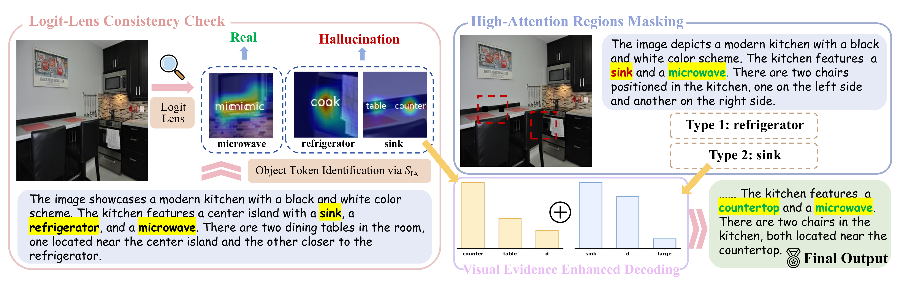
_Figure 6. Detect-Mitigate 프레임워크 전체 구조_

### Preliminary

이미지 $I$는 비전 인코더를 거쳐 이미지 토큰 $$V = \{v_1, \dots, v_N\}$$이 되고, projector $M$이 $$\tilde{v}_i = M(v_i)$$로 변환한다. 이를 시스템 토큰, 텍스트 접두부와 이어 붙인 $$X = [s_1, \dots, s_M, \tilde{v}_1, \dots, \tilde{v}_N, q_1, \dots, q_{t-1}]$$이 causal mask를 쓰는 트랜스포머 디코더에 들어간다. 생성 단계 $t$에서 출력 헤드 $W_U$는 마지막 레이어 $L$의 hidden state를 다음 토큰 분포로 바꾼다.

$$
p(x_t \mid I, X_{<t}) = \mathrm{softmax}\left(W_U h_t^{(L)}\right)
$$

어텐션 가중치는 $$\alpha_{tj} = \mathrm{softmax}\left(q_t^\top k_j / \sqrt{d_k} + m_{tj}\right)$$이며, $$m_{tj}$$는 $j \le t$이면 0, 아니면 $-\infty$인 causal mask다. Logit Lens는 같은 출력 헤드를 중간 레이어 $l$의 hidden state에 적용한다.

$$
p_{\text{lens}}^{(l)}\left(\cdot \mid h_t^{(l)}\right) = \mathrm{softmax}\left(W_U h_t^{(l)}\right)
$$

저자들은 이를 텍스트 토큰이 아닌 이미지 토큰의 hidden state에 적용해, 각 레이어에서 모델이 시각 정보를 어떤 의미로 처리하고 있는지 해석한다.

### Same Attention: Attention Magnitude Is Not to Blame

분석은 LLaVA-1.5-7B로 COCO 2014 validation 이미지 500장을 "Describe this image."로 설명하게 하고, 생성 토큰마다 모든 레이어의 어텐션 분포를 모아 진행한다. Figure 2는 레이어별로 시스템·이미지·텍스트 토큰에 가는 어텐션 비율이다. 비객체 토큰은 첫 1~2개 레이어 이후 이미지를 거의 보지 않지만, 객체 토큰은 네 단계를 거친다. 첫 1~2개 레이어에서는 이미지와 텍스트를 모두 크게 보며 맥락을 모으는 초기화 단계, 3~19층에서는 텍스트 어텐션이 우세한 단계, 20~27층에서는 이미지 어텐션이 올라와 지배적이 되는 단계, 28~32층에서는 다시 텍스트 쪽으로 돌아가 문장을 조직하는 단계다. 저자들은 세 번째 구간을 Image-Attention Stage $$\mathcal{S}_{\text{IA}}$$로 정의하고, 모델이 후보 객체의 시각 증거를 추출하는 구간으로 본다.

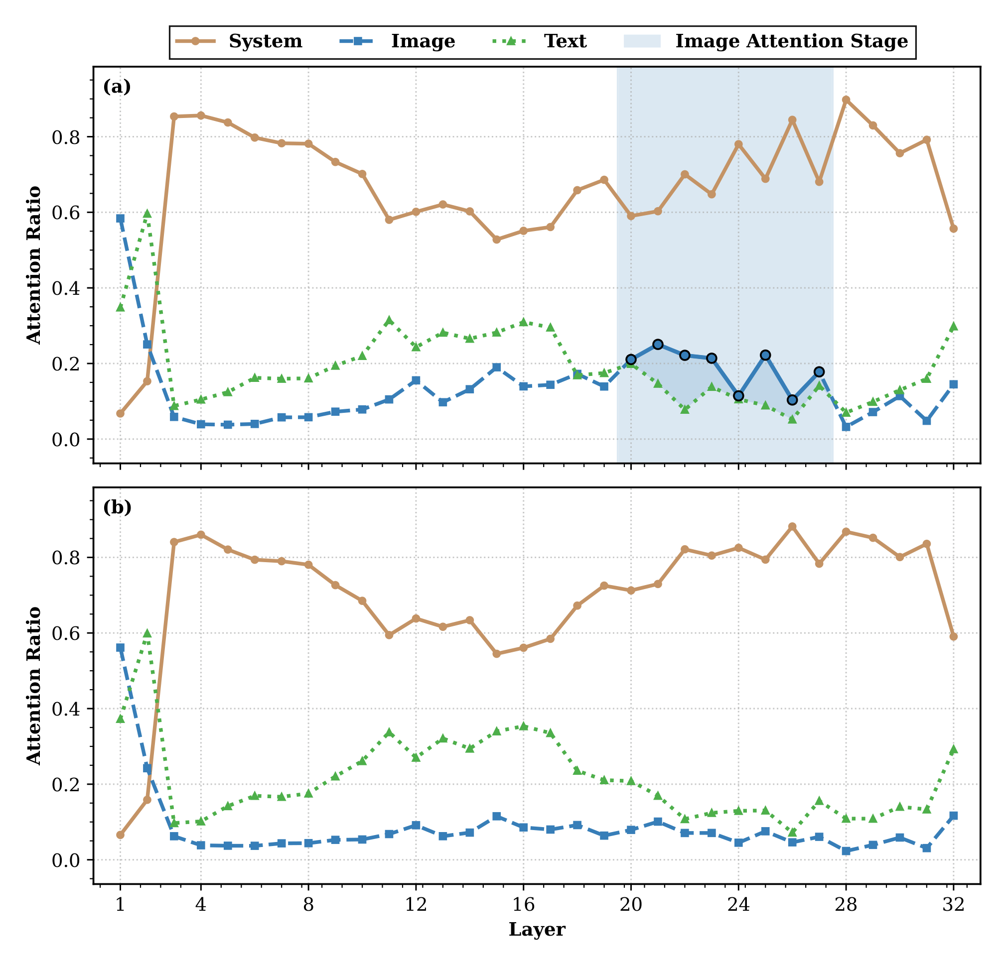{: w="766" }
_Figure 2. 객체 토큰(a)과 비객체 토큰(b)의 레이어별 어텐션 비율_

이어 CHAIR로 실제 객체 토큰과 환각 객체 토큰을 나누고 Image-Attention Stage의 평균 이미지 어텐션을 비교한다. Figure 1(b)에서 두 범주의 평균과 표준편차는 체계적인 차이를 보이지 않고, Figure 1(a)의 heatmap에서도 실제 토큰 'chair'와 환각 토큰 'bowl'이 모두 특정 영역에 비슷한 크기로 어텐션을 모은다. 저자들은 이로부터 객체 환각이 시각 어텐션 부족으로 생기지 않는다고 결론짓는다.

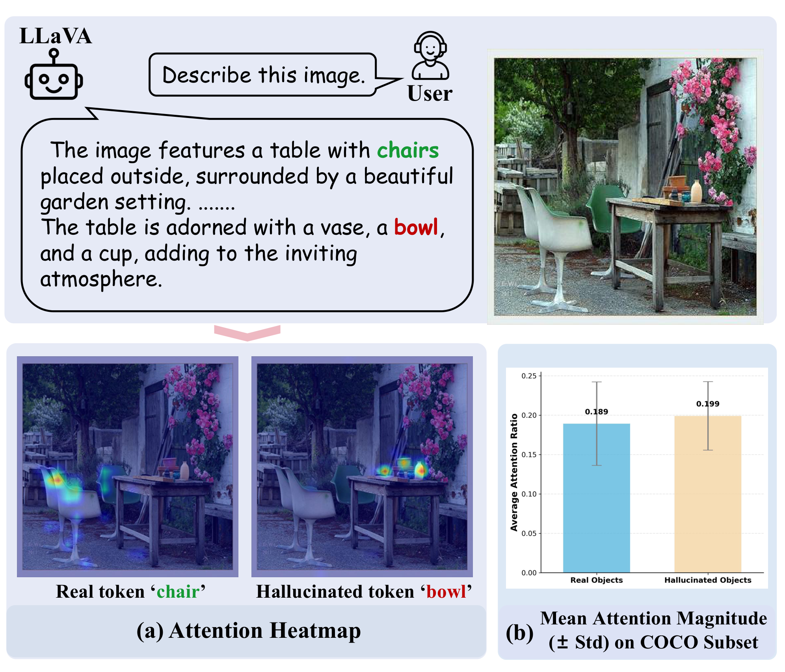{: w="507" }
_Figure 1. 실제 객체와 환각 객체의 어텐션 heatmap(a)과 평균 어텐션 크기(b)_

부록에서는 같은 분석을 LLaVA-1.5-13B, Shikra-7B, Qwen2-VL-7B로 넓힌다. Image-Attention Stage의 위치는 모델마다 다르다(LLaVA-1.5-13B는 22~29층, Shikra-7B는 19~29층, Qwen2-VL-7B는 15~28층이며 Qwen2-VL은 세 단계 구조). 그러나 부록 Figure 2에서 모든 모델이 실제·환각 객체 토큰 사이에는 유의한 차이가 없고, 두 객체 범주 모두 비객체 토큰보다 이미지 어텐션이 높다는 같은 경향을 보인다는 것이 저자들의 주장이다.

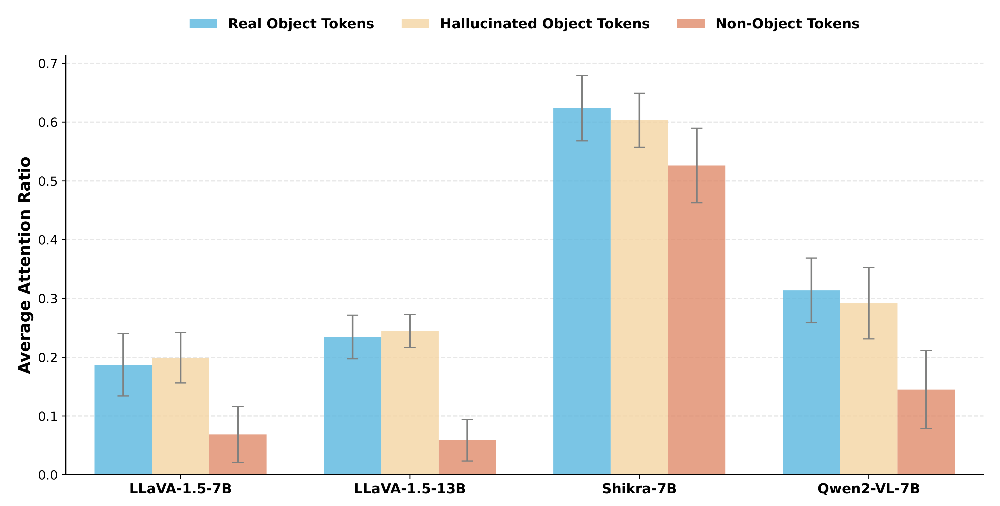
_부록 Figure 2. 네 모델의 Image-Attention Stage 평균 이미지 어텐션_

### Different Truths: Semantic Inconsistency Revealed by Logit-Lens

어텐션의 양이 같다면 차이는 무엇을 보았는가에 있어야 한다. 저자들은 Image-Attention Stage에서 어텐션 상위 $k$개 이미지 토큰의 hidden state를 Logit Lens로 어휘 공간에 투영한다. Figure 4에서 실제 객체 'suitcase'를 생성할 때 주목한 영역은 'suit', 'lug'처럼 일관된 토큰으로 읽히고, 'chair'의 영역은 'chair'로 읽힌다. 반면 환각 객체 'cell phone'을 생성할 때 주목한 영역(바닥의 흐릿한 패치)은 'resid', 'ju'처럼 무관한 토큰으로 읽히고, 'bowl'의 영역은 'pot', 'implements', 'egg'로 읽힌다. 저자들은 환각 객체 토큰에서는 어텐션이 끌어온 시각 증거가 생성 토큰을 뒷받침하지 않는 의미 불일치가 나타난다고 정리하고, 이를 탐지 방법의 직접적 근거로 삼는다.

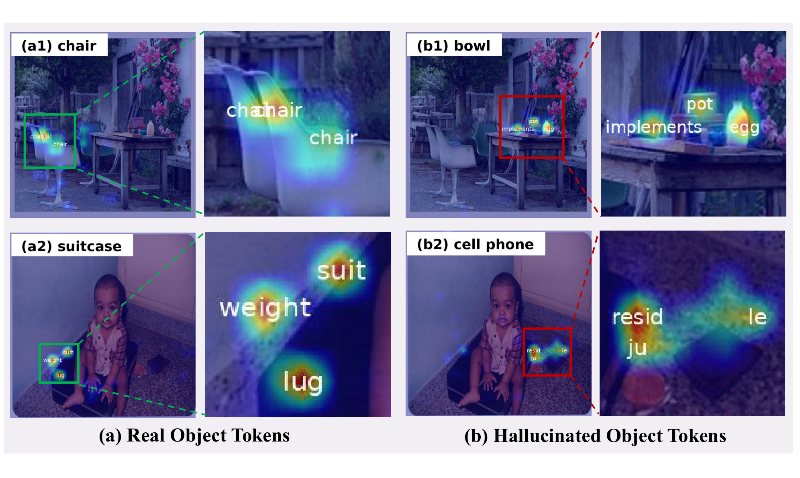{: w="567" }
_Figure 4. 실제 객체(a)와 환각 객체(b)의 고어텐션 영역 Logit Lens 디코딩_

### Two Types: Visual Uncertainty and Contextual Prior

다음 질문은 모델이 왜 그 영역에 주목했는가다. 객체 토큰 $o_t$가 Image-Attention Stage에서 각 이미지 토큰 $j$에 준 평균 어텐션을 구하고, 상위 $k$개 토큰 $$\Omega_t = \mathrm{TopK}(\bar{\alpha}_t, k)$$에 해당하는 패치를 이미지에서 가린 뒤 다시 생성한다.

$$
\bar{\alpha}_{tj} = \frac{1}{\lvert \mathcal{S}_{\text{IA}} \rvert} \sum_{l \in \mathcal{S}_{\text{IA}}} \alpha_{tj}^{(l)}
$$

Figure 5(a)에서 'bowl'의 근거였던 탁자 위 도자기 같은 영역을 가리면 'bowl'이 응답에서 사라진다. 저자들은 이런 영역이 대개 모호하거나 흐릿한 곳이며, 모델이 불확실한 시각 증거에서 강제로 의미를 뽑아내다 생긴 환각이라고 보고 visual uncertainty hallucination이라 부른다. Figure 5(b)에서는 주방 설명의 'microwave'가 고어텐션 영역을 가린 뒤에도 남고 어텐션은 다른 영역으로 옮겨 간다. 옮겨 간 영역은 'bag', 'chair'처럼 실제 있는 물체로 정확히 읽히는데도 모델은 'microwave'를 출력한다. 저자들은 이를 강한 공기 사전지식이 생성을 지배한 contextual prior hallucination으로 보고, 이때 어텐션은 객체를 생성하기 전에 "어딘가를 봐야 한다"는 절차를 채우는 루틴처럼 동작한다고 해석한다. LLaVA-1.5-7B의 500장에서 두 유형의 비율은 약 2:1이며, 저자들은 이 결과를 한 가지 처방으로는 부족하다는 근거로 삼는다.

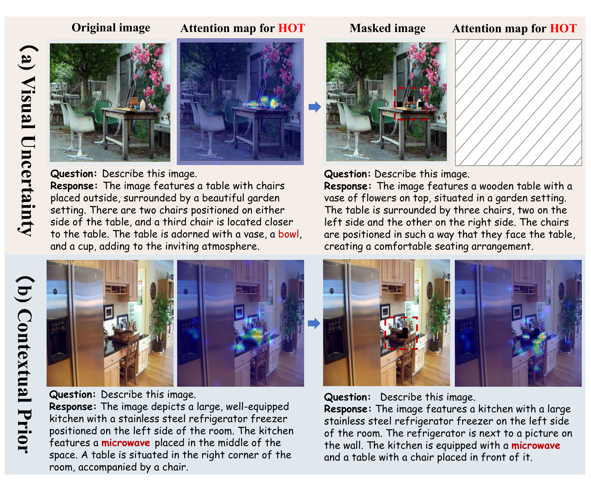
_Figure 5. 마스킹 후 사라지는 환각(a)과 남는 환각(b)_

### Hallucination Detection via Logit-Lens Consistency Check

LLCC는 세 단계로 이뤄진다. 먼저 객체 토큰을 골라낸다. 객체 토큰이 비객체 토큰보다 Image-Attention Stage에서 이미지를 훨씬 많이 본다는 관찰을 이용해, 각 생성 토큰의 평균 이미지 어텐션 합을 구하고 임계값 $$\tau_{\text{attn}}$$을 넘는 토큰만 남긴다. 부록에 따르면 색·수량 같은 형용사도 어텐션이 높게 나올 수 있어 품사 태깅으로 명사만 추가로 거른다.

$$
A_{\text{img}}(o_t) = \frac{1}{\lvert \mathcal{S}_{\text{IA}} \rvert} \sum_{l \in \mathcal{S}_{\text{IA}}} \sum_{j=1}^{N_{\text{img}}} \alpha_{tj}^{(l)}
$$

다음으로 의미 일치를 검사한다. 객체 토큰의 Image-Attention Stage 어텐션 상위 $k$개 이미지 토큰 $$\omega_t^i \in \Omega_t$$ 각각에 Logit Lens를 적용해 최고 확률 토큰을 얻는다.

$$
v_t^i = \arg\max_{v \in \mathcal{V}} \left[\mathrm{softmax}\left(W_U h(\omega_t^i)\right)\right]_v, \quad i = 1, \dots, k
$$

$v_t^i$가 'car'에 대한 'vehicle'처럼 동의어이거나 부분 토큰일 수 있으므로, WordNet 등의 유사도 함수로 목표 객체명의 유사어 집합을 만들고 유사도가 $$\tau_{\text{sim}}$$을 넘는 디코딩 토큰이 있으면 실제(0), 없으면 환각(1)으로 판정한다.

$$
\mathrm{Label}(o_t) =
\begin{cases}
0 \ (\text{Real}) & \text{if } \mathrm{Sim}(o_t, v_t^i) > \tau_{\text{sim}} \\
1 \ (\text{Hallucination}) & \text{otherwise}
\end{cases}
$$

마지막으로 환각으로 판정된 토큰의 유형을 분류한다. 고어텐션 영역을 가리고 새로 생성한 출력 $$O_{\text{new}}$$에 $o_t$가 없으면 유형 1(visual uncertainty), 남아 있으면 유형 2(contextual prior)다.

### Targeted Mitigation Methods for Hallucination

유형 1에는 HARM을 쓴다. 환각 토큰들의 상위 $k$개 고어텐션 이미지 토큰 집합 $\Omega$로 이진 마스크 $\mathbf{M}$(해당 패치면 1)을 만들고, 그 패치를 평균 색이나 0 같은 값 $\mu$로 바꾼 이미지로 같은 프롬프트를 다시 생성한다. 불확실한 시각 증거를 지워 환각의 시각적 닻을 없애는 것이 목적이다.

$$
I^{\text{mask}} = (1 - \mathbf{M}) \odot I + \mathbf{M} \odot \mu
$$

유형 2는 마스킹에 둔감하다. 원인은 실제 시각 증거가 무시되고 사전지식이 출력을 지배하는 데 있으므로, VEED는 디코딩 단계에서 고어텐션 영역의 시각 의미를 직접 주입한다. 단계 $t$에서 가장 많이 주목한 이미지 토큰의 hidden state를 Logit Lens로 읽은 시각 logit $$z_t^{\text{vis}} = W_U h(\omega_t^{\max})$$와, 고어텐션 영역을 가린 이미지로 디코딩한 logit $$z_t^{\text{mask}}$$를 섞는다.

$$
\begin{aligned}
p_t &= \mathrm{softmax}\left((1 - \alpha) \cdot z_t^{\text{vis}} + \alpha \cdot z_t^{\text{mask}}\right) \\
&= \mathrm{softmax}\left((1 - \alpha) \cdot W_U h(\omega_t^{\max}) + \alpha \cdot \mathrm{logits}_\theta(y_t \mid y_{<t}, I^{\text{mask}})\right)
\end{aligned}
$$

$\alpha$가 작을수록 고어텐션 영역의 시각 의미가 최종 결정에 더 크게 반영된다. Figure 6의 예에서 HARM으로 'refrigerator'(유형 1)가 사라진 중간 출력에 'sink'(유형 2)가 남으면, VEED가 그 자리를 영역이 실제로 읽히는 'countertop'으로 바꾼다.

## Experiments

탐지는 COCO 2014 이미지 500장을 LLaVA-1.5-7B로 설명하게 하고 CHAIR로 실제·환각 객체를 표시해 Uncertainty Score, InterConf, SVAR와 비교하며, $$\tau_{\text{attn}} = 0.15$$, $k = 3$, $$\tau_{\text{sim}} = 0.8$$을 쓴다. 완화는 COCO 2014 validation 500장의 CHAIR($$\text{CHAIR}_S$$, $$\text{CHAIR}_I$$)와 AMBER 1004장의 생성형 지표(CHAIR, Cover, Hal, Cog)로 평가하고, greedy 위에 구현한 방법을 Greedy, Beam, Nucleus와 VCD, OPERA, DeCo, Devils, PAI에 비교한다. 비교 방법은 원 논문 설정을 따라 VCD는 nucleus sampling, OPERA·DeCo는 beam search, Devils·PAI는 greedy와 결합한다.

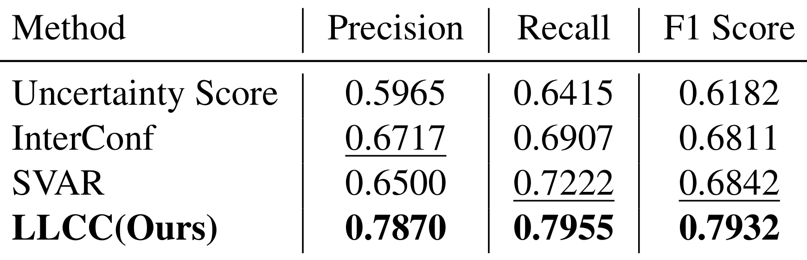{: w="307" }
_Table 1. 환각 탐지 결과_

- **고어텐션 영역 의미 검사의 탐지 우위**
  - **목적**: LLCC가 기존 환각 탐지 방법보다 정확하게 환각 토큰을 찾는지 확인
  - Table 1에서 LLCC가 Precision, Recall, F1 모두 가장 높다는 결과
  - 기존 방법은 디코딩 확률이나 여러 레이어 집계에 의존해 이미지와의 인과적 연결이 약하고, SVAR는 이미지 어텐션이 지배적이지 않은 레이어까지 합산해 신호가 희석된다는 설명
  - LLCC는 객체 토큰의 시각 출처를 먼저 특정하고 그 출처가 의미적으로 뒷받침하는지를 검사하며, 기존 방법이 하지 못하는 원인 유형 구분도 가능하다는 주장

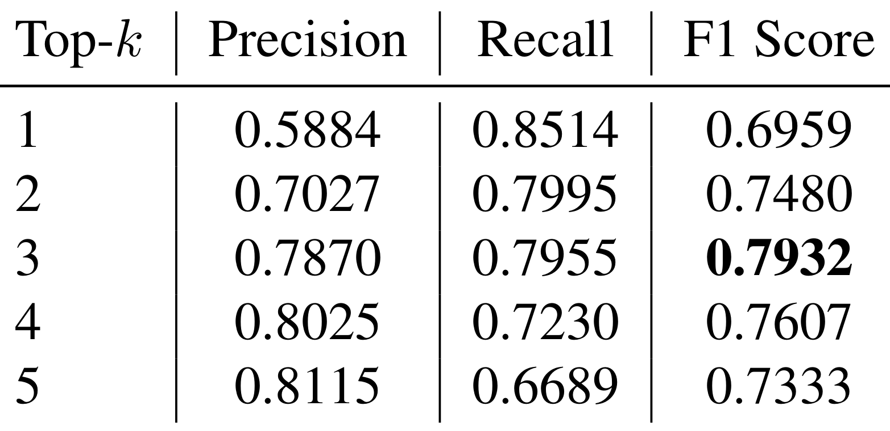{: w="232" }
_부록 Table 1. Logit Lens 디코딩 후보 수 k에 따른 탐지 성능_

- **디코딩 후보 수의 정밀도·재현율 균형**
  - **목적**: 일치 검사에 쓰는 상위 이미지 토큰 수 $k$의 영향 확인
  - 부록 Table 1에서 $k$가 커질수록 precision은 오르고 recall은 내려가며 F1은 $k=3$에서 최고라는 결과
  - $k$가 작으면 한두 패치에서 정확한 단어가 나와야 해 실제 객체도 환각으로 과판정하고, 크면 반대 경향이 나타난다는 해석

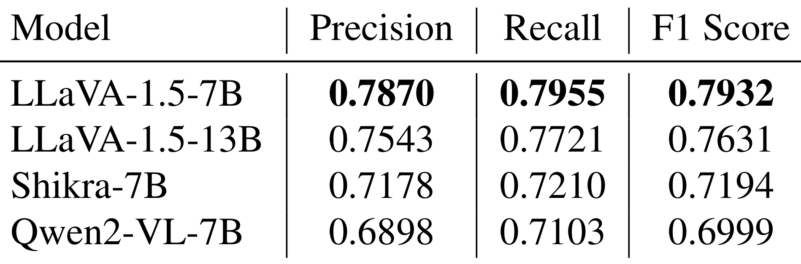{: w="289" }
_부록 Table 2. 네 모델에서의 탐지 성능_

- **모델에 따른 탐지 성능 차이**
  - **목적**: LLCC가 다른 LVLM에서도 작동하는지 확인
  - 부록 Table 2에서 LLaVA-1.5-7B가 가장 높고 Qwen2-VL-7B가 가장 낮다는 결과
  - Qwen2-VL은 Logit Lens가 마지막 1~2개 레이어에서만 의미 있는 단어를 디코딩하고 중간 레이어에서는 무관한 토큰이 나와, 일치 검사에 쓸 수 있는 레이어 범위가 좁기 때문이라는 설명

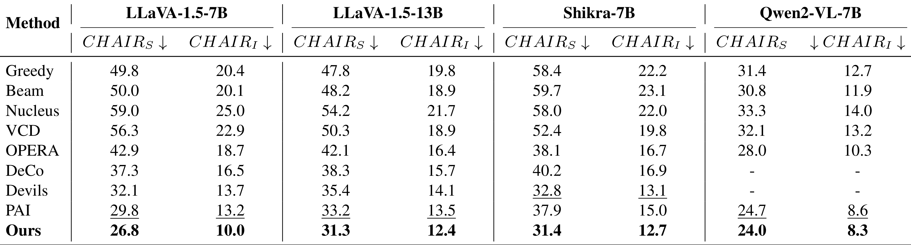{: w="775" }
_Table 2. 네 LVLM의 CHAIR 결과_

- **네 모델 전반의 CHAIR 감소**
  - **목적**: Detect-Mitigate 프레임워크가 여러 LVLM에서 객체 환각을 줄이는지 확인
  - Table 2에서 네 모델 모두 $$\text{CHAIR}_S$$와 $$\text{CHAIR}_I$$에서 가장 낮은 값을 기록한다는 결과
  - 모델 규모와 구조에 따라 절대값은 다르지만 방법 간 상대 순위가 안정적이어서 강건성을 보여준다는 주장

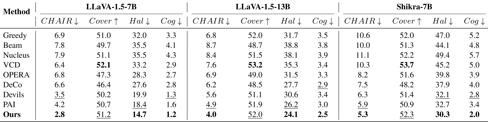
_Table 3. 세 LVLM의 AMBER 결과_

- **환각 감소와 객체 커버리지 유지**
  - **목적**: 환각을 줄이면서 이미지 속 실제 객체를 덜 언급하게 되는 부작용이 없는지 확인
  - Table 3에서 세 모델 모두 가장 낮은 환각 지표를 보이면서 Cover는 greedy와 같거나 약간 높게 유지되고, LLaVA-1.5-7B에서는 VCD 다음으로 높다는 결과
  - 다수 비교 방법은 Cover가 떨어져 유효한 내용을 희생해 환각을 줄이는 반면, 이 방법은 원래 표현을 깎지 않는다는 주장
  - 객체 토큰 위치를 특정해 원인별로 탐지하고, 최소한의 이미지 토큰만 가리며 유형 2에만 디코딩 강화를 적용해 원래 내용에 대한 영향을 제한한 덕분이라는 설명

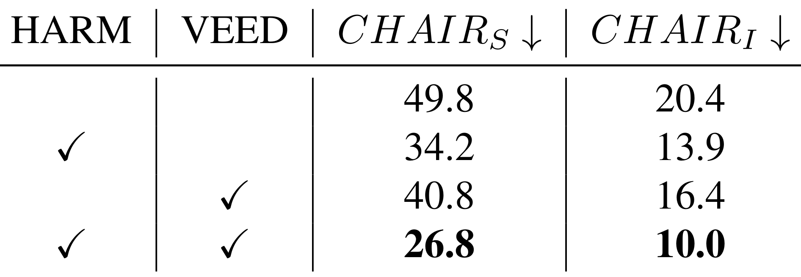{: w="276" }
_부록 Table 3. HARM과 VEED의 ablation_

- **두 처방의 상보성**
  - **목적**: 유형별로 다른 처방을 쓰는 것이 필요한지 확인
  - 부록 Table 3에서 HARM만 모든 환각 토큰에 적용해도 상당 부분이 해결되지만 사전지식 기반 환각이 남는다는 결과
  - VEED만 적용하면 개선 폭이 더 작으며, 유형 1을 처리하지 않으면 잘못된 시각 특징에 계속 오도되어 시각 신호 강화만으로는 지각 오류를 고칠 수 없다는 해석
  - 둘을 함께 쓸 때 가장 좋아, 두 기제가 서로 다르면서 공존하고 "원인에 맞는 처방"이 필요하다는 주장

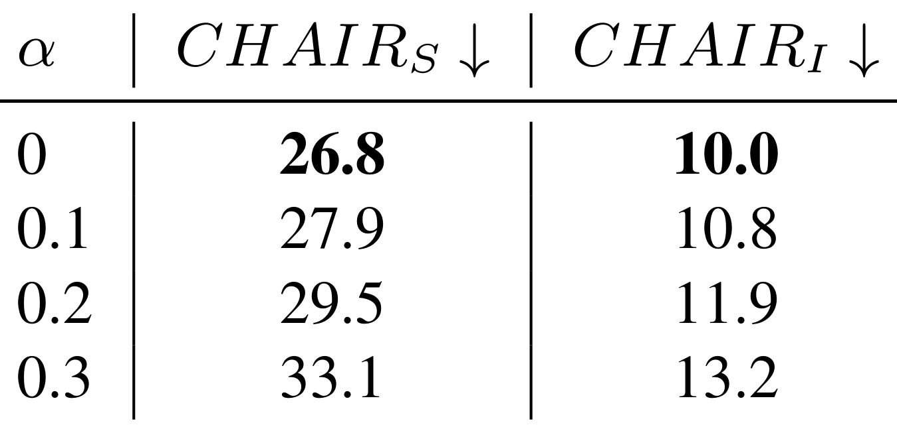{: w="206" }
_부록 Table 4. VEED 주입 강도 α에 따른 CHAIR_

- **시각 logit 주입 강도**
  - **목적**: VEED에서 시각 증거 비중 $\alpha$의 영향 확인
  - 부록 Table 4에서 $\alpha$가 커질수록 완화 효과가 줄고 $\alpha=0$, 즉 원래 logit을 Logit Lens 시각 logit으로 완전히 대체할 때 가장 좋다는 결과
  - 유형 2에서는 원래 예측에 올바른 정보가 거의 없어, 시각 증거에 전적으로 기대는 것이 사전지식을 누르는 가장 효과적인 방법이라는 해석

## Limitations & Thoughts

- **"어텐션 부족이 원인이 아니다"라는 주장의 범위**
  - 비교한 값은 Image-Attention Stage 동안 이미지 토큰 전체에 간 어텐션 합의 평균이라 공간 분포의 차이는 담지 않음. Figure 1(b)의 오차 막대가 겹치는 것은 "더 적지 않다"는 근거이지만, 부록의 "통계적으로 유의한 차이 없음"에는 검정 방법이 적혀 있지 않음
  - Devils(SVAR)는 5~18층 어텐션에서 환각 신호를 찾았고 이 논문은 20~27층에서 차이가 없다고 보므로 두 결과는 레이어 구간이 달라 직접 충돌하지 않음. "insufficient attention 설명은 불완전하다"는 본문 표현이 "어텐션 부족으로 생기지 않는다"는 결론보다 증거에 맞는 크기

- **유형 분류의 해석 문제**
  - 유형 판정은 "가리고 다시 생성한 응답에 같은 단어가 있는가"인데, Figure 5(a)처럼 마스킹 후 응답 전체가 다른 문장 경로로 바뀌므로 단어가 사라진 이유가 근거 제거인지 생성 경로 변화인지 분리되지 않음
  - 어텐션은 softmax로 어딘가에 분배되어야 하므로 "가린 뒤 다른 곳으로 옮겨 간다"는 관찰만으로 어텐션이 루틴처럼 동작한다는 결론까지 가는 것은 해석의 비중이 큼. 2:1 비율도 LLaVA-1.5-7B 한 모델의 수치

- **VEED는 사실상 단어 치환**
  - 최적값 $\alpha=0$이면 그 단계의 분포는 가장 많이 주목한 이미지 토큰 하나의 Logit Lens 출력뿐이므로, 환각 단어를 그 패치가 읽히는 단어로 바꾸는 연산이 됨
  - 부록 사례 연구에서 'microwave'가 'ventilation system'으로, 'benches'가 'Hinweis signs'처럼 독일어 토큰이 섞인 표현으로 바뀌는 예가 보임. CHAIR와 AMBER는 정해진 객체 어휘만 세므로 어휘 밖 단어로의 치환은 그대로 환각 감소로 집계됨. 치환된 단어의 정확성이나 문장 자연스러움은 평가되지 않음

- **평가 설정과 비용**
  - $k=3$, $\alpha=0$ 같은 설정을 고른 ablation이 본 결과와 같은 CHAIR 500장에서 수행됨(부록 Table 1의 $k=3$ 행은 Table 1과, 부록 Table 4의 $\alpha=0$ 행은 Table 2의 LLaVA-1.5-7B 값과 동일)
  - Table 2에서 Shikra-7B의 Ours 값과 Qwen2-VL-7B의 Greedy 값이 두 지표 모두 같음. 우연일 수 있으나 표 작성 확인이 필요한 부분(논문 확인 필요)
  - CHAIR는 응답 길이에 민감한데 방법별 응답 길이가 보고되지 않음. 부록 사례 연구의 수정 응답 중에는 원래 응답보다 언급 객체 수가 줄어든 예가 있어, Cover만으로는 이 영향을 다 볼 수 없음
  - 환각 토큰이 나올 때마다 마스킹 재생성과 추가 디코딩이 필요한데 지연 시간이나 연산량 비교가 없음
  - Image-Attention Stage 구간은 모델마다 곡선을 보고 정해야 하고, 객체 토큰 선별 임계값도 모델 의존적임. 부록 Figure 2에서 Shikra-7B는 비객체 토큰의 평균 이미지 어텐션도 0.5 안팎이라 LLaVA-1.5-7B용 $$\tau_{\text{attn}} = 0.15$$로는 객체 토큰을 거를 수 없는데, 다른 모델에 쓴 임계값은 보고되지 않음

- **Logit Lens 의존성**
  - 방법 전체가 중간 레이어 이미지 토큰을 출력 헤드로 읽을 수 있다는 전제 위에 있음. 저자들도 Qwen2-VL에서는 마지막 1~2개 레이어에서만 의미 있는 단어가 나온다고 밝히고 학습 가능한 probe를 향후 과제로 둠
  - 평가는 COCO 80개 범주 중심의 이미지 설명 과제에 한정되어 POPE 같은 판별형 평가나 속성·관계 환각은 다루지 않음

- **의료 VLM 환각 계보에서의 의미**
  - [ARCD](/paper-review/posts/2512.17189/)는 주석이나 분할 모델이 정한 해부 영역을 강조·대비하는 반면, 이 논문은 모델 자신의 어텐션이 고른 영역을 근거 후보로 삼고 그 영역의 의미를 Logit Lens로 검증한다는 점에서 "어느 영역을 볼지"를 외부에서 주는 방식과 대조적
  - 의료 VLM에 옮기려면 병변·해부 용어가 여러 부분 토큰으로 쪼개지고 일반 어휘 출력 헤드로는 잘 읽히지 않을 수 있다는 점, 흐릿하고 애매한 영역이 오히려 진단 대상인 의료 영상에서 HARM의 "불확실한 영역 제거"가 소견 자체를 지울 위험이 있다는 점이 먼저 검증되어야 함

---

이 시리즈의 다른 글: [medical-vlm-hallucination](/paper-review/categories/medical-vlm-hallucination/)

> 원문: [openaccess.thecvf.com](https://openaccess.thecvf.com/content/CVPR2026/html/Wang_Same_Attention_Different_Truths_Put_Logit-Lens_over_Visual_Attention_to_CVPR_2026_paper.html) · GitHub: [github.com/wzczc/SADT](https://github.com/wzczc/SADT) · 그림·표 출처: 원문 (CVF Open Access)
