## Summary

이 논문은 자기회귀 모델(autoregressive model, ARM)에서 개발된 locate-then-edit 지식 편집(knowledge editing)을 마스크 확산 언어 모델(masked diffusion model, MDM)로 옮겨, 파라미터 수와 깊이를 맞춘 ARM–MDM 쌍에서 "어디를 고쳐야 하는가"와 "고친 지식이 제대로 생성되는가"를 나눠 검증한다. 저자들은 편집 위치는 두 패러다임에서 같지만, 목표 객체(target object)가 여러 토큰일 때 MDM의 편집이 크게 무너지며 그 원인이 반복 디노이징(iterative denoising) 중에 거치는 부분 공개 상태(partially unmasked state)에 있다고 진단하고, 이 상태들을 편집 최적화에 포함하는 보정을 제안한다.

- **MDM에서의 locate-then-edit 첫 분석**
  - causal tracing과 직접 편집 실험 모두에서, 양방향으로 학습된 MDM도 ARM과 같은 위치(마지막 주어 토큰의 초중반 레이어 MLP)에 사실 회상이 모이고 그곳의 편집이 가장 효과적이라는 주장

- **Multi-token breakdown과 그 원인 진단**
  - 단일 토큰 목표에서는 MDM 편집이 ARM과 비슷하게 성공하지만 목표가 길어질수록 체계적으로 무너진다는 발견
  - 편집 최적화에 쓰는 완전 마스크 상태(fully masked state)와 생성 중에 거치는 부분 공개 상태의 불일치를 원인으로 지목하고, 단일 토큰이 대부분인 표준 벤치마크가 이를 가린다는 점을 KAMEL 기반 다중 토큰 평가로 보여 줌

- **Intermediate-state correction**
  - 목표 토큰 일부를 무작위로 공개한 상태들까지 포함해 편집 값을 최적화하는 단순한 보정으로 다중 토큰 편집 성능을 상당 부분 회복

- **편집 방법과 모델 전반의 일반성**
  - 같은 붕괴와 보정 효과가 AlphaEdit, PMET과 세 개의 추가 ARM–MDM 쌍에서도 나타난다는 주장

## Background

지식 편집은 언어 모델이 가진 특정 사실을 고치면서 나머지 지식은 유지하는 작업이다. 사실은 주어 $s$, 관계 $r$, 객체 $o$의 튜플 $(s, r, o)$로 표현되며, 편집은 주어진 $(s, r)$에 대해 객체를 새 목표 객체 $o^\ast$로 바꾼다. 예를 들어 "Lionel Messi plays for FC Barcelona"를 "Inter Miami"로 바꾸는 식이다. Locate-then-edit 계열은 먼저 모델 내부를 분석해 사실이 인과적으로 저장된 위치를 찾고, 그 위치의 가중치만 수정한다. 한편 MDM은 LLaDA, Dream처럼 다음 토큰 예측 대신 가려진 토큰을 양방향 문맥에서 복원하도록 학습되고, 완전히 가려진 출력에서 시작해 몇 개씩 토큰을 채워 나가는 반복 디노이징으로 생성한다. 저자들이 묻는 것은 ARM의 동작 방식에서 도출된 편집 위치와 편집 절차가 이렇게 다르게 학습되고 다르게 생성하는 모델에도 통하는가이다.

- **① Fine-tuning 기반 수정 (Zhu et al., 2020)**
  - **방식**: 새 사실로 모델 전체 또는 제약을 건 일부 파라미터를 fine-tuning
  - **한계**: 전체 모델 학습의 비용, 수정 문장에 대한 과적합과 무관한 지식의 catastrophic forgetting, 제약을 걸어도 편집 문구에 과적합해 paraphrase로 일반화되지 않는 경향

- **② 외부 모듈 활용 (SERAC, GRACE, KE, MEND)**
  - **방식**: 편집을 외부 메모리에 저장해 추론 시 검색하거나, 보조 네트워크가 가중치 갱신량을 예측
  - **한계**: 보조 네트워크 방식은 편집이 모델 내부 분석이 아니라 별도 네트워크에 위임되어 편집 위치를 해석할 근거가 없고, 외부 메모리 방식은 모델을 바꾸지 않아 모델 안의 지식 자체는 그대로 남음

- **③ Locate-then-edit (ROME, MEMIT, AlphaEdit, PMET, SUIT)**
  - **방식**: causal tracing으로 사실 회상의 핵심 지점(마지막 주어 토큰의 초중반 레이어 MLP)을 찾고, 그 MLP를 key–value 연상 기억(associative memory)으로 보고 닫힌 형태의 갱신으로 새 사실을 기록
  - **한계**: 개발과 검증이 전적으로 ARM에서 이루어졌고, 편집 위치 자체가 다음 토큰 예측으로 학습된 ARM의 내부 분석에서 도출됨

- **④ ARM과 MDM의 비교 연구 (Pan et al., 2026; LongLLaDA; Piskorz et al., 2025; DLM-Scope)**
  - **방식**: 지식 습득, 긴 문맥 동작, 덧붙인 마스크 토큰이 문맥 이해에 주는 영향, sparse autoencoder로 본 내부 표현 등을 비교
  - **한계**: 표현이나 추론 시 동작에 초점을 둘 뿐, 사실이 어디에 저장되는지와 그것을 어떻게 편집할지는 다루지 않음

네 계열 가운데 편집 위치를 해석 가능한 근거 위에서 고르고 부작용을 줄인 대량 동시 편집까지 확장된 것은 locate-then-edit이지만, 그 근거인 causal tracing 결과와 편집 절차는 모두 왼쪽에서 오른쪽으로 다음 토큰을 예측하는 ARM을 전제로 만들어졌다. ARM과 MDM을 비교한 연구들은 이 전제가 MDM에서도 성립하는지 확인하지 않았다. 저자들은 학습 목적과 생성 방식이 다른 MDM에서 ARM 기반 locate-then-edit의 편집 위치 가정과 편집 절차가 그대로 유효한지가 검증되지 않았다는 문제를 제기한다.

## Method

Locate-then-edit은 MLP의 down-projection 행렬을 사전처럼 본다. 마지막 주어 토큰에서 down-projection으로 들어가는 벡터(up-projection 활성값)가 key로서 "Lionel Messi"라는 개체를 나타내고, 그 key에 대해 down-projection이 내놓는 벡터가 value로서 "어느 팀에서 뛰는가" 같은 속성을 담는다. 편집은 두 단계다. 먼저 그 위치의 value를 얼마만큼 밀어야 모델이 "Inter Miami"를 출력하는지를 경사 하강으로 찾고(목표 value 최적화), 다음으로 그 key가 새 value로 대응되도록 행렬을 닫힌 형태로 고치면서 다른 key–value 쌍은 최대한 보존한다. MDM으로 옮길 때 저자들이 따로 묻는 질문은 둘이다. 하나는 위치의 문제로, 양방향 문맥으로 학습된 MDM에서도 그 사전이 같은 곳에 있는가이다. 다른 하나는 절차의 문제로, 목표 value를 어떤 입력 상태에서 최적화하는가이다.

두 번째 질문이 이 논문의 핵심이다. ARM에서는 목표 value를 최적화할 때 프롬프트 뒤에 정답 목표 토큰을 이어 붙이고, causal attention 아래에서 각 목표 토큰을 앞선 목표 토큰들에 조건화해 채점한다. "Inter"는 프롬프트만 보고, "Miami"는 프롬프트와 "Inter"를 보고 채점된다. 이는 생성이 올바르게 진행될 때 모델이 실제로 보게 되는 상태와 정확히 같다. 저자들의 MDM 직접 이식(MEMIT†)은 답 자리에 목표 토큰 수만큼 마스크를 놓고, 모든 목표 토큰을 이 완전 마스크 상태 하나에서 동시에 예측하도록 최적화한다. 이것은 디노이징의 첫 단계와만 일치한다. 실제 생성은 확신도(confidence)가 높은 위치부터 한 칸씩 채워 나가므로, 둘째 단계부터는 "Inter"가 이미 채워지고 나머지가 마스크인 상태처럼 최적화 때 한 번도 보지 않은 입력이 들어온다. 목표가 한 토큰이면 첫 단계가 곧 마지막 단계라 불일치가 생기지 않고, 그래서 단일 토큰 목표가 대부분인 COUNTERFACT에서는 이 문제가 드러나지 않는다. 저자들의 보정은 목표 value를 최적화하는 동안 정답 목표 토큰 중 무작위 부분집합을 공개한 상태들을 섞어 넣어, 디노이징이 어떤 순서로 진행되더라도 거칠 수 있는 상태들에서 편집이 유지되게 하는 것이다.

이 구성은 Background의 한계에 각각 대응한다. Locate-then-edit이 ARM에서만 검증되었다는 문제(③)에는 편집 알고리즘을 그대로 두고 입력 형식만 마스크 예측에 맞게 바꾼 MEMIT†를 만들고, causal tracing과 직접 편집 sweep 두 가지로 위치 가정을 MDM에서 다시 검증하는 방식으로 대응한다. 기존 비교 연구가 사실의 위치와 편집을 다루지 않았다는 문제(④)에는 파라미터 수와 레이어 깊이를 맞춘 ARM–MDM 쌍, 특히 Qwen2.5에서 초기화된 Dream과 Qwen2.5의 쌍으로 같은 분석을 나란히 수행해 모델 용량의 차이를 통제한다. 외부 모듈 방식(②)과 달리 편집 위치를 인과 분석에 근거시킬 수 있다는 점 때문에 locate-then-edit을 출발점으로 택한다. Fine-tuning(①)과의 관계는 제약 fine-tuning을 같은 편집 묶음에 적용해 MDM에서도 편집이 paraphrase 일반화에서 앞서는지 다시 확인한다. ARM의 편집 절차가 생성 과정과 맞물려 있다는 암묵적 전제는 MDM에서 깨지므로, 위치가 아닌 최적화 상태를 고치는 intermediate-state correction을 더한다.

이 논문에는 전체 방법 구조를 보여 주는 overview 그림이 없다. 아래 도식은 두 패러다임에서 편집 최적화가 보는 상태와 생성이 거치는 상태의 관계를 정리한 것이다 (목표 "Inter Miami", `[M]`은 마스크 토큰).

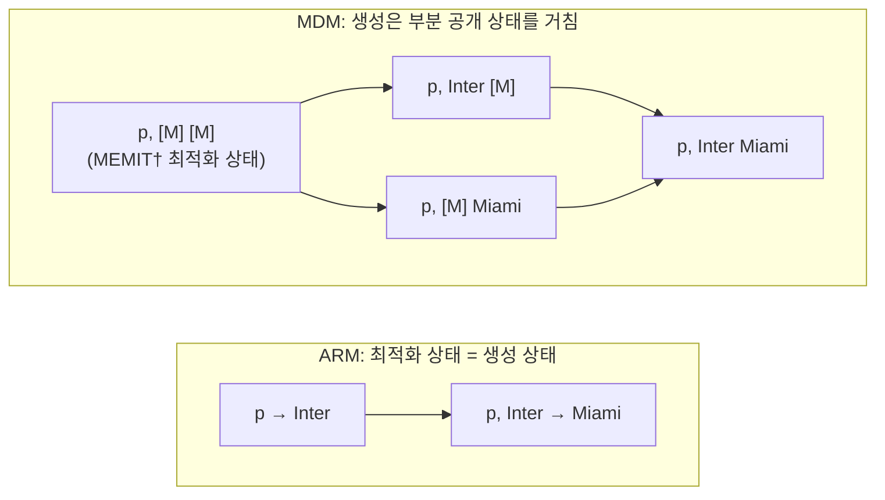

### Preliminaries

Locate-then-edit은 Transformer MLP의 down-projection $W$를 key $k$를 value $v$로 대응시키는 선형 연상 기억 $Wk = v$로 본다. key는 주어 $s$의 마지막 토큰에서의 up-projection 활성값이고, value는 $(r, o)$를 담는다. 편집은 같은 key가 $(r, o^\ast)$를 담는 새 value $v^\ast$로 대응되도록 갱신량 $\Delta$를 더하는 것, 즉 $(W + \Delta)k \approx v^\ast$이다. 목표 value는 $v^\ast = v + \delta$이고, 잔차 $\delta$는 편집 위치의 value를 $v + \delta$로 바꾼 모델 $$G(v \leftarrow v + \delta)$$가 프롬프트 $p$에서 $o^\ast$를 내놓을 확률을 최대화하도록 경사 하강으로 구한다.

$$
\delta = \arg\min_{\tilde{\delta}} \; -\log P_{G(v \leftarrow v + \tilde{\delta})}\left(o^\ast \mid p\right)
$$

MEMIT은 여러 사실을 한 번에 편집한다. 기존 key들의 Gram 행렬 $C = KK^\top$와 새 key 행렬 $K_1$, 새 목표 value 행렬 $V_1$에 대해 정규방정식을 풀면 갱신량이 닫힌 형태로 나온다.

$$
\Delta = R K_1^\top \left(C + K_1 K_1^\top\right)^{-1}, \qquad R = V_1 - W K_1
$$

사전학습 때 저장된 key들은 알 수 없으므로 $C$는 표본 입력으로 추정한 $$\lambda \mathbb{E}[kk^\top]$$로 대신하고, $\lambda$는 새 연상과 기존 연상 사이의 균형을 정한다. MEMIT은 이 갱신을 연속한 여러 MLP 레이어에 나눠 쓴다. $\delta$는 편집 범위의 마지막 레이어에서 한 번 최적화하고, 아래 레이어부터 차례로 남은 잔차를 아직 편집하지 않은 레이어 수로 나눈 몫만큼 흡수하게 하며, 레이어를 하나 고칠 때마다 key와 남은 잔차를 다시 계산한다. 저자들이 강조하는 점은 $\delta$가 하나의 조건화 상태에서만 맞춰진다는 것이다. 이는 모델이 목표를 생성할 때도 같은 상태를 만난다는 가정을 암묵적으로 깔고 있다.

MDM의 순방향 과정은 시퀀스 $x_0$의 각 토큰을 확률 $t \in [0, 1]$로 흡수 상태(absorbing state)인 마스크 $M$으로 독립적으로 바꾸고, 모델은 부분 마스크 시퀀스 $x_t$에서 가려진 토큰을 동시에 복원하는 mask predictor $$p_\theta(\cdot \mid x_t)$$를 학습한다. 손실은 가려진 위치에서만 계산한다.

$$
\mathcal{L}(\theta) = -\mathbb{E}_{t, x_0, x_t}\left[\frac{1}{t} \sum_{i=1}^{L} \mathbf{1}\left[x_t^i = M\right] \log p_\theta\left(x_0^i \mid x_t\right)\right]
$$

$t$는 $[0, 1]$에서 균등하게 뽑는다. 이 정식화의 두 성질이 이 연구에 중요하다. mask predictor는 causal mask 없이 입력 전체를 보므로 모든 위치가 양방향 문맥에서 예측되고, locate-then-edit이 고치는 사실 지식도 ARM과 다른 학습 목적 아래에서 형성된다. 주 분석의 두 MDM 중 LLaDA는 처음부터 학습되었고, Dream은 Qwen2.5 가중치에서 초기화한 뒤 예측을 ARM과 정렬하는 shifted objective로 학습되었다. 생성은 길이 $L$의 완전 마스크 출력에서 시작해, 매 단계 모든 마스크 위치의 분포를 예측하고 일부 위치를 골라 top-1 예측으로 채우며 나머지는 다음 단계로 남긴다. 위치 선택 규칙으로는 각 위치의 top-1 확률을 확신도로 삼아 높은 위치부터 공개하는 confidence-based unmasking을 기본으로 쓴다. 따라서 다중 토큰 생성은 일부만 채워진 중간 상태들을 반드시 지나며, 이런 상태는 왼쪽에서 오른쪽으로 생성하는 ARM에는 대응물이 없다.

### Transferring Locate-then-Edit to MDMs

MEMIT†는 MEMIT의 닫힌 형태 풀이, key–value 틀, $\delta$ 최적화 루프를 그대로 두고, MEMIT이 forward pass를 돌리는 네 가지 입력을 모두 "프롬프트 + 목표 토큰 수만큼의 마스크 블록" 형태로 바꾼다. 다시 쓰기 프롬프트에서는 마스크 위치의 logit을 $o^\ast$로 지도하고, 무관한 예측을 안정시키는 KL 정규화의 기준 프롬프트도 마스크 위치에서 logit을 읽는다. key와 닫힌 형태 잔차의 기준 value도 같은 마스크 입력에서 마지막 주어 토큰의 hidden state로 읽는다. ARM에서는 causal attention 때문에 마지막 주어 토큰의 hidden state가 뒤에 무엇이 붙든 같아서 최적화 대상과 잔차 기준이 자동으로 일치하지만, MDM에서는 뒤에 붙은 마스크가 양방향 attention을 통해 주어 위치의 hidden state를 바꾸므로 네 입력을 같은 마스크 문맥으로 맞춰야 한다는 것이 저자들의 설명이다. 이 입력은 MDM 생성의 초기 상태와 같다.

하이퍼파라미터는 retuning 없이 구조가 같은 ARM에서 물려받는다 (LLaDA는 LLaMA, Dream은 Qwen의 설정). 모델마다 정하는 것은 편집 레이어뿐이다. COUNTERFACT의 별도 500개 사실에서 연속 4개 레이어 창을 모두 시험해 efficacy와 generalization 순위 합이 가장 좋은 창을 고르며, 그 결과 LLaMA-3은 L1–4, LLaDA는 L4–7, Qwen2.5는 L7–10, Dream은 L4–7이 선택된다. specificity는 efficacy와 상충해 가장 높은 창이 편집을 덜 하는 경향이 있어 기준에서 뺀다.

위치 분석에는 Meng et al.의 causal tracing을 따른다. 깨끗한 실행에서 모든 위치와 레이어의 hidden state를 기록하고, 주어 토큰 임베딩에 $\nu = 3\sigma$의 가우시안 잡음을 더해 정답 예측을 무너뜨린 뒤, 특정 위치 $\hat{i}$, 레이어 $\hat{l}$의 hidden state 또는 MLP·attention 기여를 깨끗한 값으로 복원했을 때 정답 확률이 얼마나 돌아오는지를 잰다. 단일 레이어의 기여는 작아서 하위 모듈은 $\hat{l}$을 중심으로 10개 레이어 창을 함께 복원한다. 모델마다 잡음으로 생긴 확률 차이가 크게 달라 회복량을 그 차이에 대한 비율로 정규화한다.

$$
\mathrm{normAIE}(\hat{i}, \hat{l}) = \mathbb{E}_{\text{facts}}\left[\frac{P_{\text{restored}}(o) - P_{\text{corrupted}}(o)}{P_{\text{clean}}(o) - P_{\text{corrupted}}(o)}\right] \times 100\%
$$

MDM에서는 프롬프트 뒤에 마스크 8개를 붙여 생성 시 문맥과 비슷하게 만들고, 첫 마스크 위치에서 $o$의 첫 토큰 확률을 읽는다. 층별 기여를 직접 보기 위해 반복 디노이징이 아니라 마스크 입력에 대한 단일 forward pass로 추적하며, 깨끗한 모델이 이미 맞히는 사실만 쓰는 필터 때문에 추적 대상은 단일 토큰 답으로 제한된다.

### A Correction for Intermediate States

보정은 $\delta$를 맞추는 조건화 상태만 바꾸고, 가중치 갱신 규칙과 편집 레이어는 건드리지 않는다. $N$개 토큰 목표 $(t_1, \dots, t_N)$에 대해 첫 최적화 단계는 완전 마스크 상태($k = 0$)를 쓴다. 이후 단계마다 공개할 개수 $k$를 $\lbrace 0, \dots, N-1 \rbrace$에서 균등하게 뽑고, 그 크기의 위치 부분집합 $R$을 균등하게 뽑아 $R$의 위치에는 정답 토큰 $t_i$를 채우고 나머지는 마스크로 둔 뒤, 남은 $N - k$개 마스크 위치에서 정답 토큰을 예측하도록 $\delta$를 갱신한다. 본문 서술을 위 $\delta$ 최적화 식의 형태로 옮기면 다음과 같다 ($x_R$은 $R$의 위치만 정답으로 채운 답 블록).

$$
\delta = \arg\min_{\tilde{\delta}} \; \mathbb{E}_{R}\left[-\sum_{i \notin R} \log P_{G(v \leftarrow v + \tilde{\delta})}\left(t_i \mid p, x_R\right)\right]
$$

상태를 매 단계 독립적으로 뽑으므로 특정 공개 순서나 디코딩 경로를 가정하지 않는다는 것이 저자들의 설계 의도다. 최적화가 완전 마스크 상태 하나에 몰리지 않고 $N$개의 공개 개수 수준에 나뉘므로, 각 수준이 충분히 최적화되도록 최적화 예산을 단일 상태 기준선보다 늘린다(LLaDA 4배, Dream 2배). Dream은 $\delta$의 norm clamp도 그에 맞춰 완화한다.

같은 보정을 MEMIT을 다르게 확장한 두 방법에도 적용한다. AlphaEdit은 MEMIT의 목표 value 최적화를 그대로 두고 최종 가중치 갱신만 보존할 지식의 null space로 제한하며, PMET은 attention과 MLP 잔차를 함께 최적화한 뒤 MLP 잔차만 가중치에 쓴다. 두 방법 모두 마스크 입력 이식(AlphaEdit†, PMET†)을 적용하고, 다중 토큰 목표에서 같은 부분 공개 입력을 더한다.

## Experiments

주 분석은 파라미터 수와 깊이를 맞춘 두 쌍, LLaMA-3-8B-Instruct / LLaDA-8B-Instruct와 Qwen2.5-7B-Instruct / Dream-v0-Instruct-7B로 수행하고, LLaMA-3-8B-Instruct / LLaDA-1.5-8B, LLaMA-2-7B / DiffuLLaMA-7B, GPT-2-medium / DiffuGPT-m의 세 쌍을 추가로 쓴다. COUNTERFACT에서는 MEMIT의 설정대로 500개 사실을 한 묶음으로 편집하고, efficacy(다시 쓰기 프롬프트가 $o^\ast$를 생성), generalization(paraphrase 프롬프트가 $o^\ast$를 생성), specificity(같은 관계·객체를 가진 다른 주어의 프롬프트가 원래 $o$를 유지)를 모두 생성 결과에 목표 문자열이 포함되는지로 판정한다. specificity는 편집 전 모델이 이웃 사실을 회상하는 능력도 반영하므로 편집 전 값과 비교해 읽어야 한다. 생성 길이는 새 목표와 원래 객체 중 긴 쪽의 토큰 수로 두고, ARM은 greedy 디코딩, MDM은 그 길이의 마스크에서 확신도 순으로 한 단계에 한 위치씩 공개한다. 다중 토큰 분석은 KAMEL을 COUNTERFACT 형식으로 바꿔, 목표 길이 $N \in \lbrace 1, 2, 3, 4 \rbrace$마다 쌍의 두 토크나이저에서 같은 길이인 사실 200개씩 쓴다.

### What Transfers: Locating and Editing Facts

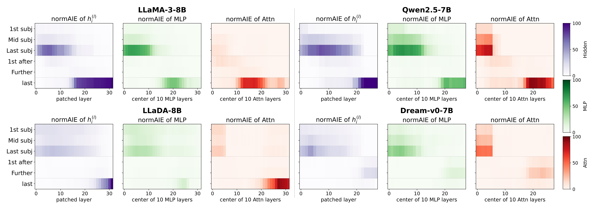
_Figure 1. 네 모델의 causal tracing_

- **두 인과 지점의 공유**
  - **목적**: 양방향으로 학습된 MDM에서도 사실 회상이 ARM과 같은 위치에 국소화되는지 확인
  - Figure 1에서 네 모델 모두 마지막 주어 토큰의 초중반 레이어에 MLP가 주도하는 초기 지점과, 답 위치의 상위 레이어에 attention이 주도하는 후기 지점이 나타난다는 결과
  - 후기 지점은 예측을 읽어 내는 곳이라 예상된 것이고, Meng et al.이 사실 회상의 자리로 본 초기 지점이 LLaDA와 Dream에서도 같은 곳에 나타난다는 주장
  - MDM의 초기 지점은 ARM보다 약하고 넓게 퍼져 있으며, Qwen과 Dream에는 초기 레이어 attention의 이차 기여가 함께 보이는데 이는 Dream이 Qwen에서 초기화된 것과 부합한다는 설명

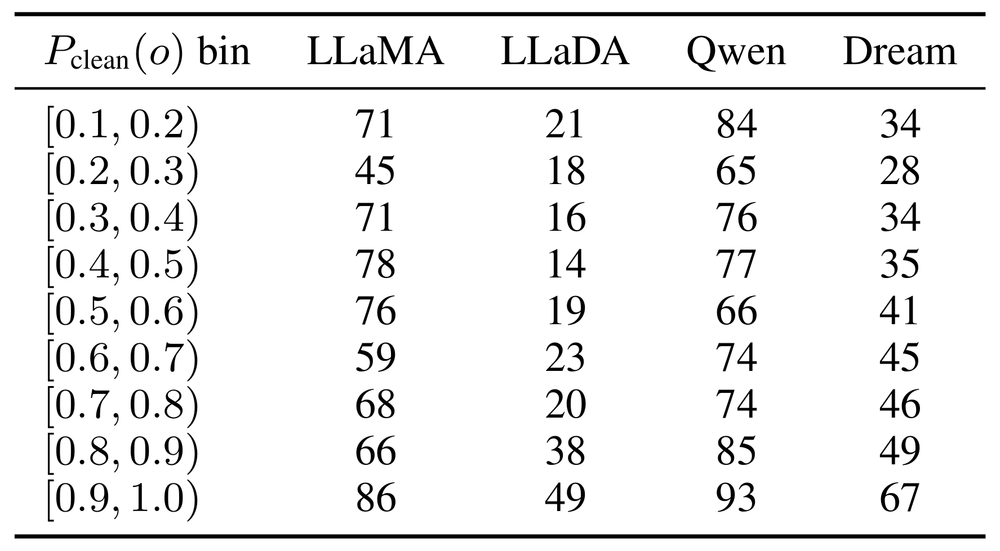{: w="331" }
_Table 10. 확신도 구간별 초기 지점 normAIE 정점_

- **MDM 국소화가 약한 이유**
  - **목적**: MDM의 정점이 약한 것이 단지 두 모델의 확신도 분포 차이 때문인지 확인
  - Table 10에서 깨끗한 실행의 정답 확률 구간을 맞춰도 모든 구간에서 MDM 정점이 짝 ARM보다 낮다는 결과
  - 두 모델의 구간 내 평균 확률이 거의 같으므로, MDM의 사실 회상은 위치는 같되 더 많은 레이어와 위치에 분산되어 있다는 해석

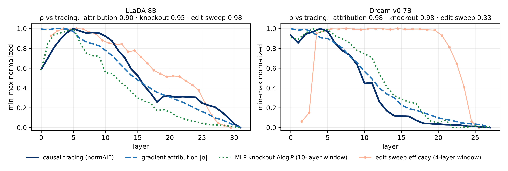
_Figure 4. 세 국소화 기법과 편집 sweep의 레이어별 비교_

- **국소화 결과의 기법 독립성과 편집 레이어와의 관계**
  - **목적**: 위치 결론이 causal tracing이라는 특정 기법에 의존하는지, 그리고 국소화가 최적 편집 레이어를 정해 주는지 확인
  - Figure 4에서 activation×gradient attribution과 MLP knockout이 두 MDM 모두에서 causal tracing과 높은 순위 상관을 보여, 개입·기울기·제거라는 서로 다른 기법이 같은 토큰–레이어 위치를 가리킨다는 결과
  - LLaDA에서는 편집 sweep도 tracing과 같이 움직이지만, Dream에서는 국소화 점수가 초중반 이후 떨어지는 반면 편집 efficacy는 훨씬 넓은 레이어 범위에서 높게 유지됨
  - 이는 회상에 가장 인과적으로 관여하는 부분이 가장 효과적인 편집 위치와 같을 필요는 없다는 Hase et al.의 관찰과 부합하며, 편집 레이어를 tracing이 아니라 직접 측정으로 고른 근거라는 설명

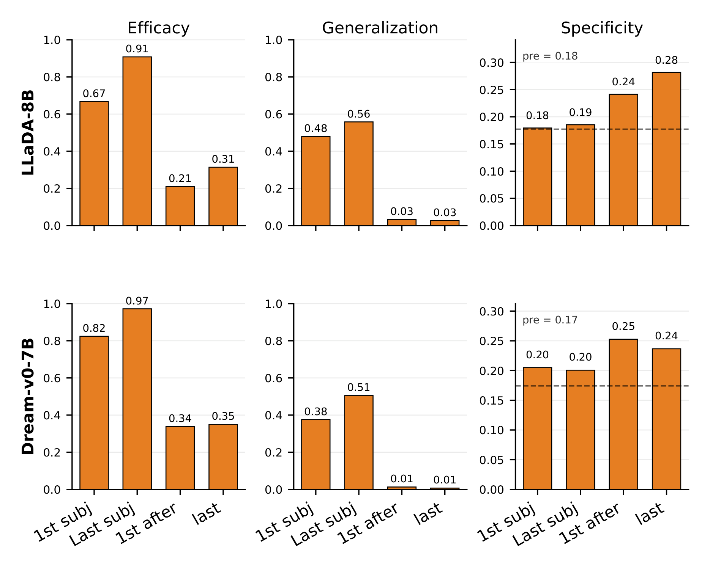{: w="616" }
_Figure 2. MDM의 편집 토큰 위치 ablation_

- **편집 토큰 위치**
  - **목적**: 어느 토큰 위치를 편집하는 것이 가장 효과적인지 직접 측정
  - Figure 2에서 두 MDM 모두 마지막 주어 토큰에서 efficacy와 generalization이 가장 높고, 첫 주어 토큰도 강하며, 주어 이후 위치에서는 급격히 떨어진다는 결과
  - 양방향 attention으로 모든 토큰이 주어 전체를 볼 수 있는데도 Meng et al.의 ARM 회상 지점, causal tracing 결과와 같은 양상이라는 주장

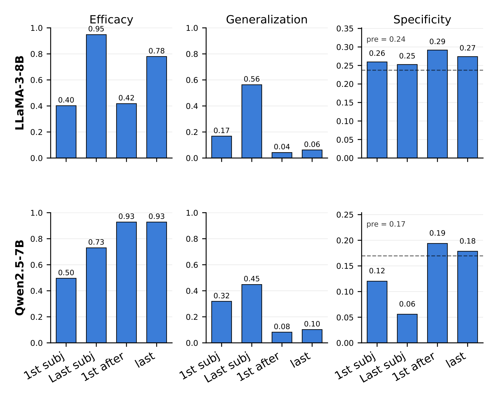{: w="616" }
_Figure 6. ARM의 편집 토큰 위치 ablation_

- **ARM에서의 대조**
  - **목적**: 같은 위치 ablation을 짝 ARM에 적용한 기준 결과 제시
  - Figure 6의 ARM 결과는 MDM에서 본 경향을 그대로 반영한다는 저자들의 정리

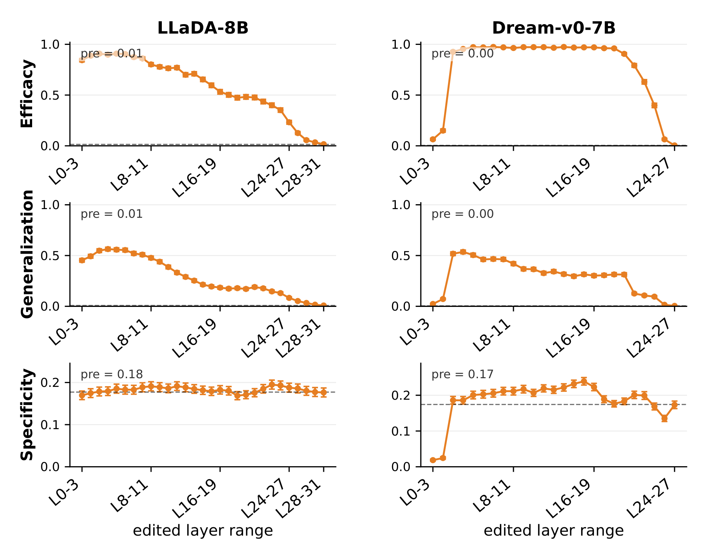{: w="654" }
_Figure 3. MDM의 편집 레이어 범위 ablation_

- **편집 레이어 범위**
  - **목적**: 어느 레이어 범위를 편집하는 것이 효과적인지 직접 측정
  - Figure 3에서 편집은 넓은 레이어 범위에서 성공하고, efficacy와 generalization은 초중반 범위에서 가장 강하다는 결과
  - 이 범위는 causal tracing 지점과 겹치지만 정확히 일치하지는 않아, 모델별 편집 레이어를 직접 측정으로 정했다는 설명

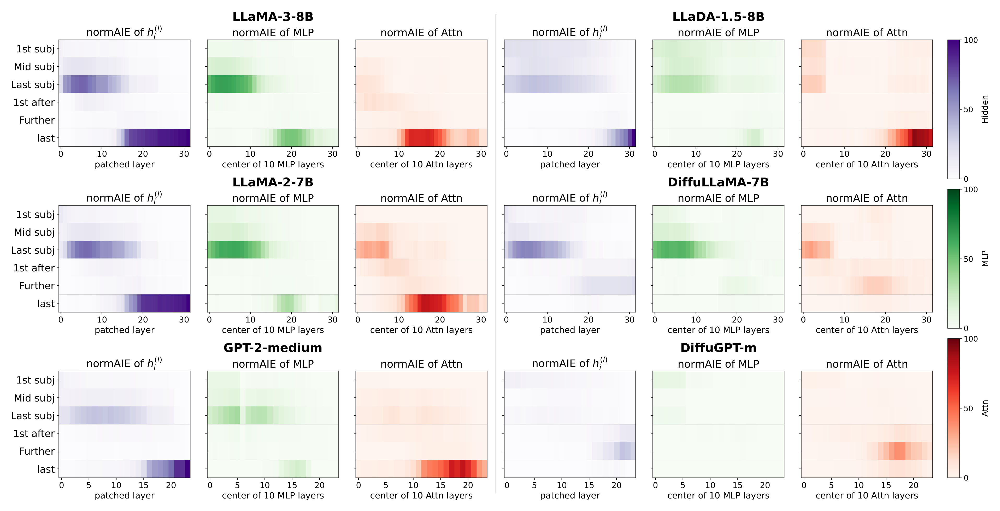
_Figure 7. 추가 세 쌍의 causal tracing_

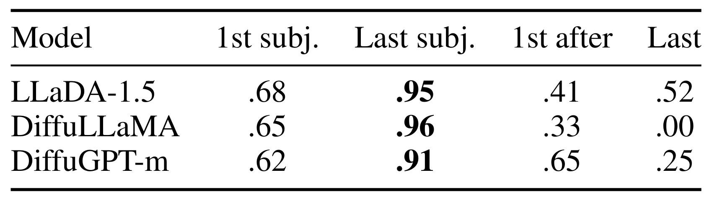{: w="317" }
_Table 21. 추가 MDM의 편집 토큰 위치 ablation_

- **추가 모델 쌍에서의 위치 일반성**
  - **목적**: 위치 결론이 다른 모델 계열과 규모로 확장되는지 확인
  - Figure 7에서 여섯 모델 중 다섯은 마지막 주어 토큰에서 초기 MLP 효과가 가장 강하고, DiffuGPT-m만 첫 주어 토큰에서 정점을 보이지만 효과는 여전히 주어 구간의 초기 레이어에 머문다는 결과
  - Table 21에서 세 추가 MDM 모두 마지막 주어 토큰 편집의 efficacy가 가장 높고, 주어 구간 밖에서는 대체로 낮아진다는 결과
  - 따라서 정밀한 인과 정점이 곧 최적 편집 위치라고 해석하지는 않으며, 두 분석은 "주어 내부, 초기 레이어 영역"이라는 넓은 수준에서 일치한다는 주장

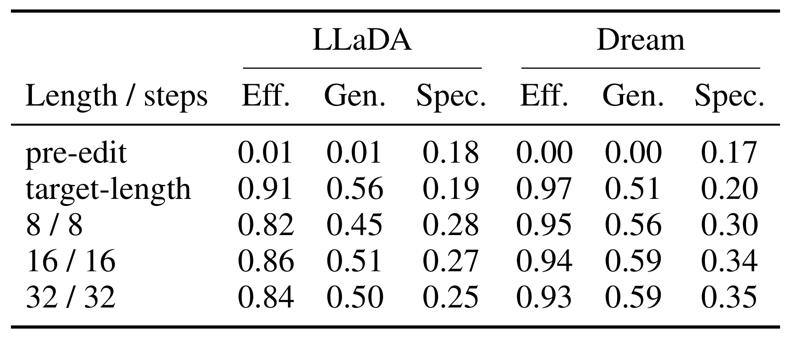{: w="337" }
_Table 12. 생성 길이와 디노이징 스텝 변화에 따른 편집 성능_

- **디코딩 설정 변화에 대한 강건성**
  - **목적**: 목표 길이에서만 최적화한 편집이 MDM의 생성 길이와 디노이징 스텝 수가 바뀌어도 유지되는지 확인
  - Table 12에서 생성 길이와 스텝을 함께 늘려도 두 MDM의 efficacy가 유지되고 generalization과 specificity에도 일관된 저하가 없다는 결과
  - 편집이 최적화되지 않은 디코딩 설정으로도 옮겨 간다는 주장 (단 COUNTERFACT는 대부분 단일 토큰 목표)

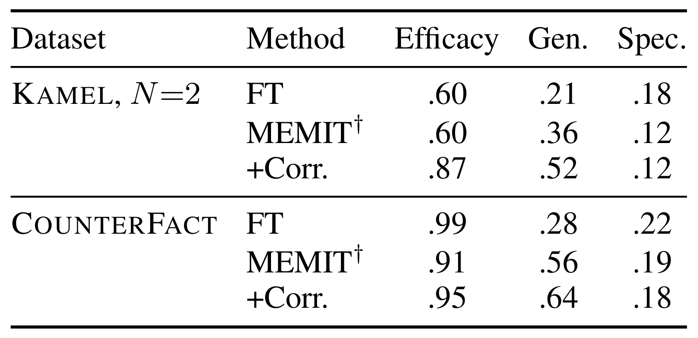{: w="305" }
_Table 27. LLaDA에서 제약 fine-tuning과 편집의 비교_

- **MDM에서도 유지되는 편집의 일반화 우위**
  - **목적**: ARM에서 지식 편집을 쓰는 이유인 fine-tuning 대비 paraphrase 일반화 우위가 MDM에서도 성립하는지 확인
  - fine-tuning은 제약 강도를 sweep해 가장 좋은 설정을 쓰고, 그 설정에서 무관한 일반 능력이 보존됨을 확인한 뒤 비교
  - Table 27에서 fine-tuning은 원래 편집 프롬프트에는 맞지만 paraphrase로는 훨씬 덜 일반화되고, 보정을 더한 편집은 비슷한 specificity에서 훨씬 높은 generalization을 보인다는 결과
  - COUNTERFACT에서 fine-tuning의 efficacy가 거의 완벽한데도 generalization이 낮은 것은 최적화 실패가 아니라 편집 문구에 대한 과적합이라는 해석

### What Breaks: Editing Multi-Token Facts

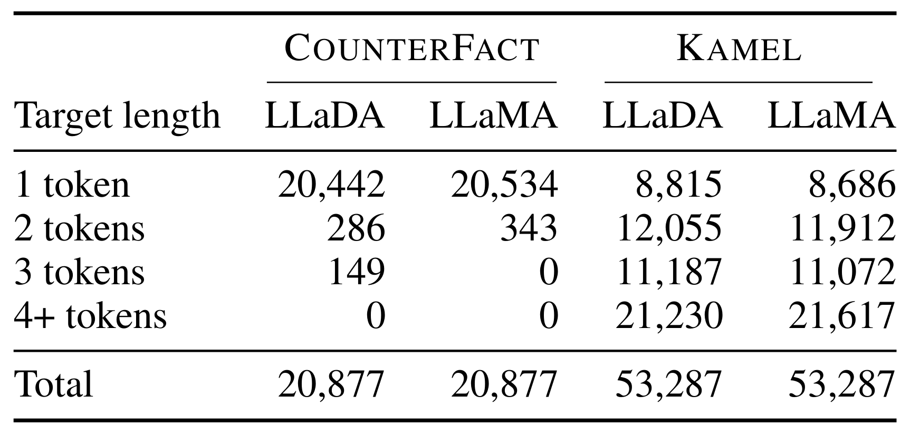{: w="322" }
_Table 1. 각 토크나이저에서의 목표 토큰 길이 분포_

- **표준 벤치마크가 가리는 문제**
  - **목적**: 기존 편집 평가에서 목표 객체 길이가 어떻게 분포하는지 확인
  - Table 1에서 COUNTERFACT의 목표는 거의 모두 단일 토큰이고 4토큰 이상은 없는 반면, KAMEL은 넓은 길이 범위에 걸쳐 있다는 결과
  - COUNTERFACT에서도 소수의 다중 토큰 목표는 실패율이 훨씬 높지만 예가 너무 적어 길이별 체계적 비교가 불가능하므로, KAMEL로 길이를 통제한 평가를 만든 근거라는 설명

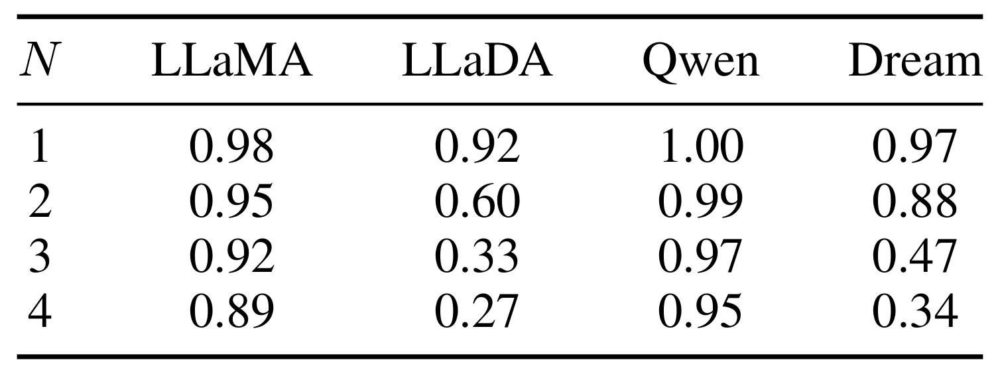{: w="281" }
_Table 2. KAMEL의 목표 토큰 길이별 편집 efficacy_

- **목표 길이에 따른 붕괴**
  - **목적**: 목표가 길어질 때 ARM과 MDM의 편집 성능이 어떻게 달라지는지 확인
  - Table 2에서 네 모델 모두 단일 토큰 목표에서는 높은 efficacy를 보이지만, 길이가 늘수록 LLaMA와 Qwen은 조금만 떨어지는 반면 LLaDA와 Dream은 급격히 떨어진다는 결과
  - 각 쌍의 두 모델은 길이마다 같은 사실로 평가되므로, 벌어지는 격차를 사실 선택의 차이로 돌릴 수 없다는 주장

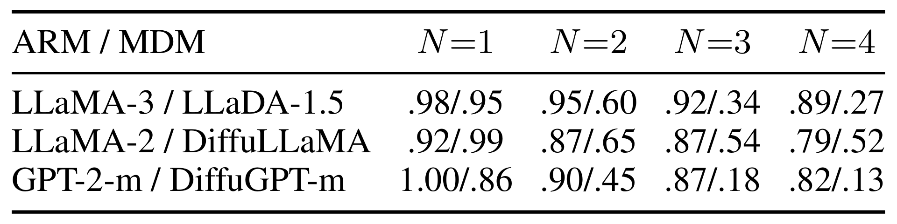{: w="358" }
_Table 22. 추가 세 쌍의 목표 길이별 efficacy_

- **붕괴의 모델 독립성**
  - **목적**: 다중 토큰 붕괴가 특정 MDM 계열이나 초기화 방식, 규모에 한정되는지 확인
  - Table 22에서 세 추가 쌍 모두 단일 토큰에서는 높고 길이가 늘수록 ARM–MDM 격차가 벌어진다는 결과
  - ARM 가중치에서 초기화된 DiffuLLaMA와 DiffuGPT-m에서도 같은 양상이므로, 붕괴는 마스크 확산 모델 전반에서 반복된다는 주장

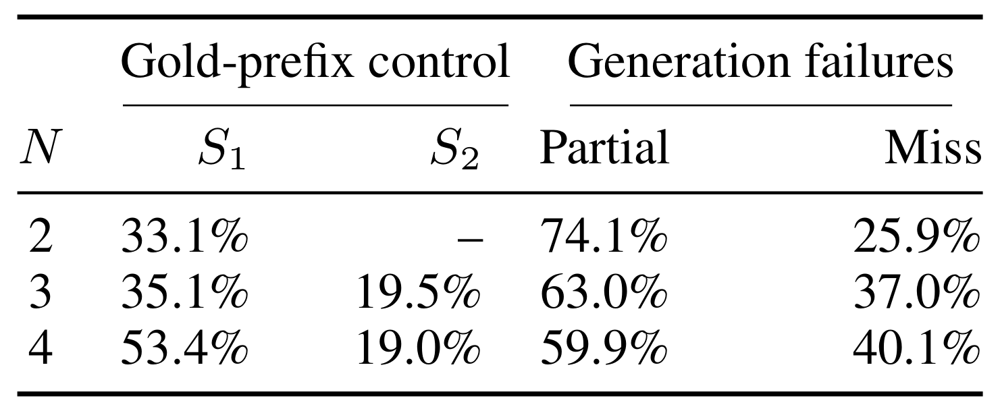{: w="276" }
_Table 3. LLaDA의 다중 토큰 편집 실패 분석_

- **중간 상태에서 무너지는 편집**
  - **목적**: 완전 마스크 상태에서 성공한 편집이 목표 토큰이 공개되면서 효력을 잃는지 확인
  - 앞의 $j$개 정답 목표 토큰을 공개하고 나머지를 마스크로 둔 상태 $S_j$를 각각 따로 forward pass로 평가하되, 완전 마스크 상태 $S_0$에서 모든 목표 위치의 top-1이 정답인 경우만 남김. 공개 토큰이 모델 생성이 아닌 정답이므로 생성 중 오류 전파와 분리된 상태 변화의 효과만 보는 설계
  - Table 3 왼쪽에서 정답 토큰 하나만 공개해도 남은 suffix 중 하나 이상이 틀리게 되는 경우가 상당하고, 가장 긴 목표에서 그 비율이 가장 높다는 결과
  - Table 3 오른쪽에서 실제 생성 실패 중 목표 토큰 일부를 맞는 위치에 남긴 부분 실패가 모든 다중 토큰 길이에서 다수라는 결과
  - 편집이 완전 마스크 상태에서는 모든 목표 토큰을 맞히다가, 최적화 때 보지 못한 중간 상태를 지나며 목표의 일부만 잃는다는 해석과 부합한다는 주장

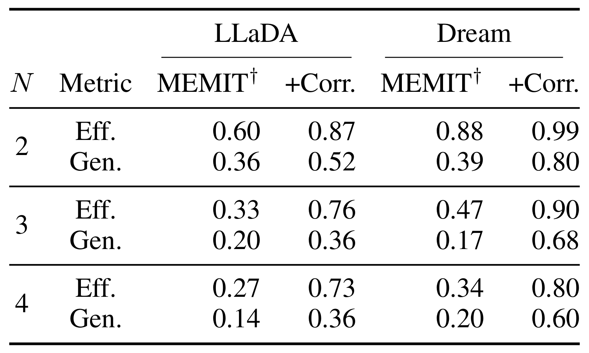{: w="299" }
_Table 4. KAMEL 다중 토큰 목표에서 보정의 효과_

- **보정에 의한 다중 토큰 편집 회복**
  - **목적**: 부분 공개 상태를 최적화에 포함하면 다중 토큰 편집이 회복되는지 확인
  - Table 4에서 LLaDA와 Dream 모두 모든 목표 길이에서 efficacy와 generalization이 오른다는 결과
  - 저자들은 특히 LLaDA의 가장 긴 목표에서의 efficacy 회복과 Dream의 $N = 2$ generalization 상승을 강조

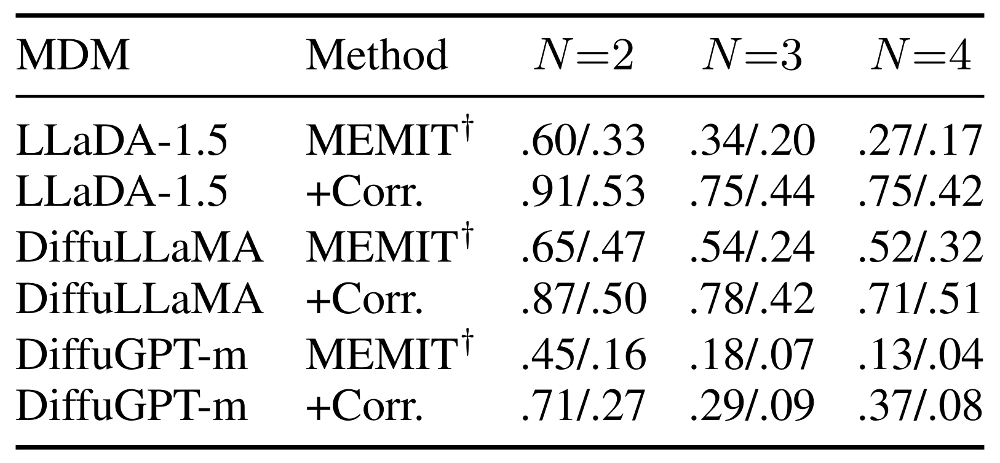{: w="303" }
_Table 23. 추가 세 MDM에서 보정의 효과_

- **추가 MDM에서의 보정 효과**
  - **목적**: 보정의 효과가 주 분석의 두 MDM에 한정되는지 확인
  - Table 23에서 세 모델 모두 모든 목표 길이에서 efficacy와 generalization이 오르며, 훨씬 작은 DiffuGPT-m에서도 효과가 일관된다는 결과
  - 다만 긴 목표에서 격차가 남으므로, 이 불일치가 다중 토큰 붕괴의 유일한 원인은 아니라는 것이 저자들의 단서

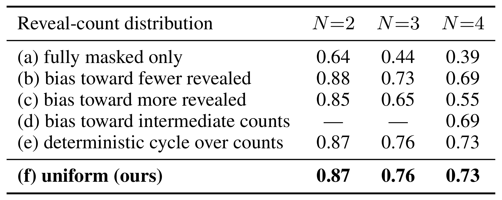{: w="362" }
_Table 18. 공개 개수 분포 ablation (LLaDA)_

- **공개 개수의 분포**
  - **목적**: 공개 개수의 분포가 보정 효과에 주는 영향을 확인하고, 늘린 최적화 예산의 효과와 분리
  - 모든 변형이 늘린 예산을 공유하므로, (a)는 Table 4의 MEMIT†와 달리 예산만 늘리고 부분 공개는 하지 않은 대조군
  - Table 18에서 부분 공개를 더한 모든 변형이 (a)보다 높아, 효과가 추가 최적화 단계가 아니라 공개 상태의 분포에서 온다는 주장
  - 어느 분포도 모든 길이에서 최고는 아니며, 적게 공개하는 쪽으로 치우친 분포가 많이 공개하는 쪽보다 일관되게 낫고, 중간 개수에 몰아도 균등 분포보다 낫지 않다는 결과. 고정된 일정 없이 모든 개수를 덮으면서 긴 목표에서 최고 결과와 같은 균등 분포를 기본값으로 둔다는 설명

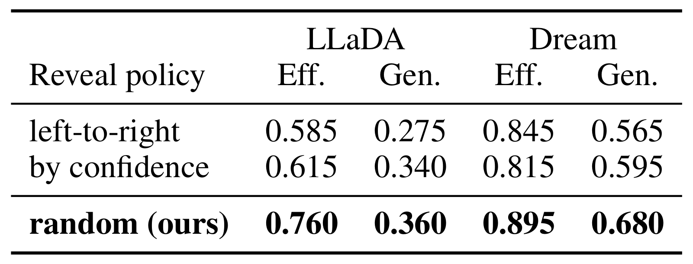{: w="298" }
_Table 19. 공개 위치 선택 방식 ablation_

- **공개 위치의 선택 방식**
  - **목적**: 공개 개수를 고정한 상태에서 공개 위치 선택 방식의 영향 확인
  - Table 19에서 매 단계 위치를 무작위로 다시 뽑는 방식이 두 모델 모두에서 efficacy와 generalization 최고라는 결과
  - 고정된 왼쪽→오른쪽 순서가 두 모델에서 generalization이 가장 낮아 $\delta$가 그 순서에 과적합하는 반면, 무작위 재추출은 $\delta$를 여러 위치 조합에 강건하게 만든다는 해석

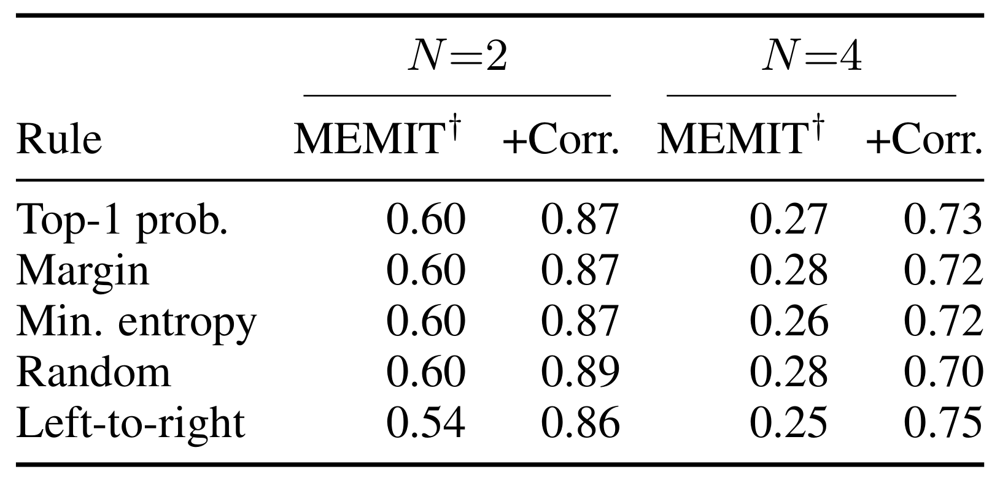{: w="304" }
_Table 5. 디코딩 위치 선택 규칙별 efficacy (LLaDA)_

- **디코딩 위치 선택 규칙에 대한 강건성**
  - **목적**: 평가 때 디코딩이 어떤 위치를 먼저 공개하든 보정 효과가 유지되는지 확인
  - 단계당 한 위치 공개로 고정하고 top-1 확률, top-1과 top-2의 margin, 최소 entropy, 무작위, 왼쪽→오른쪽 다섯 규칙을 비교
  - Table 5에서 다섯 규칙 모두 보정이 MEMIT†보다 일관되게 높다는 결과

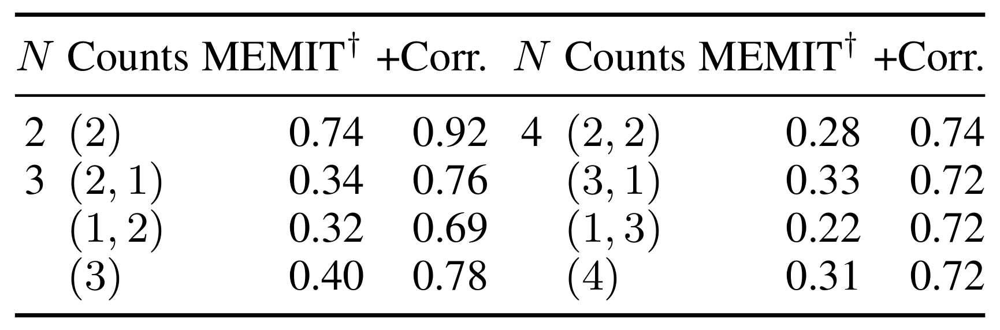{: w="323" }
_Table 6. 단계당 공개 개수 일정별 efficacy (LLaDA)_

- **단계당 공개 개수에 대한 강건성**
  - **목적**: 한 단계에 여러 위치를 공개하는 디코딩 일정에서도 보정 효과가 유지되는지 확인
  - top-1 확률 규칙으로 고정하고 단계별 공개 개수 일정을 바꿔 비교. 예를 들어 $N = 3$의 (2, 1)은 첫 단계에 두 위치, 둘째 단계에 나머지 한 위치를 공개
  - Table 6에서 모든 일정에서 보정이 MEMIT†보다 높아, 어느 위치를 몇 개씩 공개하든 보정이 효과적이라는 주장

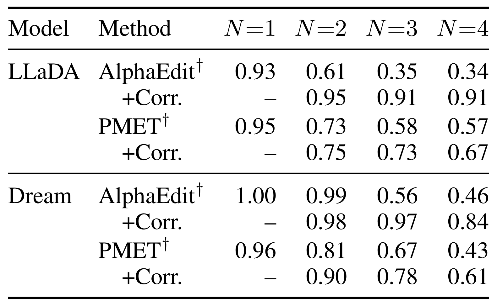{: w="295" }
_Table 7. AlphaEdit과 PMET의 목표 길이별 efficacy_

- **다른 locate-then-edit 방법으로의 일반화**
  - **목적**: 붕괴와 보정 효과가 MEMIT의 원래 정식화에 특수한 것인지 확인
  - Table 7에서 보정이 없으면 두 방법 모두 두 모델에서 길이에 따라 efficacy가 떨어지고, 보정을 더하면 회복된다는 결과
  - 회복은 AlphaEdit에서 더 큰데, AlphaEdit은 최종 풀이만 바꿔 보정된 목표 value를 그대로 null space 제약 갱신에 넘기는 반면 PMET은 함께 최적화한 attention 잔차를 가중치에 남기지 않아 이득이 작을 수 있다는 설명

### Broader Evaluation of Edited Models

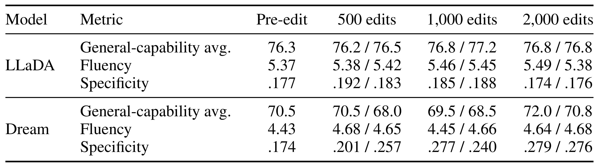{: w="517" }
_Table 25. 편집 수 증가에 따른 일반 능력, 유창성, specificity_

- **편집 규모를 늘렸을 때의 모델 보존**
  - **목적**: 편집과 보정이 무관한 능력, 생성 품질, 이웃 사실 보존을 해치는지, 동시 편집 수가 늘 때 누적 손상이 생기는지 확인
  - 일반 능력은 SST-2, MRPC, CoLA, RTE, NLI, 5-shot MMLU 여섯 과제 평균으로 재며, MDM의 likelihood는 정확히 계산되지 않고 Monte Carlo ELBO로 추정해 분산이 크므로 perplexity 대신 정확도를 씀
  - Table 25에서 LLaDA는 세 지표 모두 모든 편집 규모에서 편집 전 값 근처에 머물고, Dream도 유창성과 specificity에서 체계적 저하가 없다는 결과
  - Dream에서 +Corr.의 일반 능력 평균이 MEMIT†보다 다소 낮지만 편집 수에 따라 단조롭게 나빠지지는 않으며, 편집 수가 늘어도 보존 지표가 단조롭게 악화된다는 증거는 없다는 주장

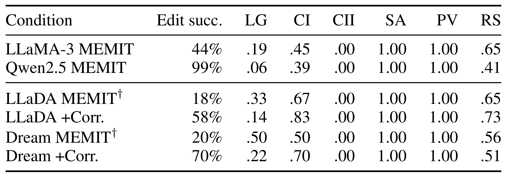{: w="422" }
_Table 26. RippleEdits Popular split 결과_

- **관련 지식의 전파와 보존**
  - **목적**: 편집한 사실이 논리적으로 연결된 사실로 전파되는지와 관련 지식이 보존되는지 확인
  - Table 26에서 Popular split의 개체는 대부분 다중 토큰이라 MEMIT†는 초기 편집 검증 단계부터 자주 실패하고, 보정은 두 MDM 모두에서 검증 성공률을 크게 높인다는 결과. 다중 토큰 편집의 어려움이 이 벤치마크에서도 재현된다는 주장
  - 축별 정확도는 검증을 통과한 편집에서만 계산되어 조건마다 부분집합이 다르므로 통제된 비교가 아니라는 단서. 보정 후 Logical Generalization이 낮아 보이는 것도 더 많고 어려운 편집이 포함된 결과이며, 두 조건이 모두 성공한 작은 공통 부분집합에서는 값이 같다는 설명
  - 관련 지식에 대한 효과에는 더 강한 결론을 내리지 않는다는 것이 저자들의 정리

## Limitations & Thoughts

- **"원인이 확인되었다"는 결론의 강도**
  - 결론은 중간 상태를 포함하면 성능이 대부분 회복되어 원인이 확인되었다고 쓰지만, Table 4의 +Corr.는 최적화 예산을 LLaDA 4배, Dream 2배로 늘리고 Dream에서는 norm clamp까지 푼 설정이고 MEMIT†는 기본 예산이다. Table 18의 (a)처럼 예산만 늘려도 LLaDA efficacy가 $N = 2, 3, 4$에서 0.60→0.64, 0.33→0.44, 0.27→0.39로 오르므로, $N = 4$의 전체 상승(0.27→0.73) 중 약 4분의 1은 예산 효과다. 예산을 맞춘 대조는 LLaDA에서만 보고되고 Dream에는 없음
  - Table 3의 gold-prefix 진단에는 편집하지 않은 모델의 대조가 없다. 원래 다중 토큰 사실에 대해서도 정답 토큰 하나를 공개하면 나머지 예측이 흔들리는지를 함께 보였다면, 불안정이 "편집이 그 상태에 최적화되지 않아서"인지 MDM의 다중 토큰 예측 자체의 성질인지 분리할 수 있었을 것
  - 저자들도 부록에서 이 불일치가 유일한 원인은 아니라고 쓰므로, "중요한 원인 중 하나"가 증거에 맞는 크기

- **"회복"의 범위**
  - efficacy 기준으로도 $N = 4$에서 LLaDA 0.73 대 LLaMA 0.89, Dream 0.80 대 Qwen 0.95로 격차가 남고, DiffuGPT-m은 0.37에 그친다 (Table 2, 4, 23)
  - Table 7의 회복 폭은 방법과 길이에 따라 고르지 않다. $N = 2$에서 Dream AlphaEdit은 0.99→0.98로 조금 낮아지고 LLaDA PMET은 0.73→0.75에 그치며, PMET은 $N = 4$에서도 0.57→0.67(LLaDA), 0.43→0.61(Dream)로 AlphaEdit(0.91, 0.84)보다 크게 낮음
  - generalization은 보정 후에도 LLaDA $N = 4$에서 0.36이며, KAMEL에서 ARM의 generalization은 보고되지 않아 ARM 수준까지 얼마나 회복했는지 판단할 수 없다. paraphrase도 KAMEL이 관계당 템플릿 하나만 제공해 저자들이 관계당 하나씩 작성한 것이라 generalization 추정의 다양성이 좁음
  - 남은 격차에 대한 한 가지 가설(리뷰어 추측): MEMIT†는 key를 완전 마스크 입력에서 읽는데, 양방향 attention 때문에 답 자리에 토큰이 채워지면 마지막 주어 토큰의 hidden state, 즉 편집된 MLP에 들어가는 key 자체도 바뀐다. 본문 서술상 보정은 $\delta$ 최적화 상태만 바꾸고 key 추출은 그대로 두므로, 생성 중 key 이동에 대한 대응은 빠져 있음

- **"같은 위치"의 해상도**
  - 선택된 편집 창은 LLaMA-3 L1–4, LLaDA L4–7, Qwen2.5 L7–10, Dream L4–7로, 같은 가중치에서 출발한 Qwen과 Dream도 세 레이어 차이가 난다. 전이되는 것은 "주어 구간 내부의 초기 레이어"라는 거친 수준의 위치
  - Figure 6에서 Qwen2.5의 efficacy는 주어 이후 위치와 답 위치(0.93)가 마지막 주어 토큰(0.73)보다 높고 generalization만 마지막 주어 토큰에서 가장 높다. ARM 결과가 MDM의 경향을 그대로 반영한다는 부록의 정리는 이 차이를 다루지 않음
  - Table 10에서 MDM 정점은 짝 ARM의 18~57%(LLaDA), 41~72%(Dream)에 그치고, Figure 4의 Dream은 편집 sweep과 tracing의 상관이 0.33이다. 회상이 분산된 모델에서 단일 지점 편집이 단일 토큰 목표에 잘 통한다는 사실 자체가 흥미롭지만, 왜 그런지는 설명되지 않음

- **평가 지표의 해상도**
  - specificity는 생성 기반이라 편집 전 값이 0.17~0.18로 낮고, Table 12에서 생성 길이를 8 이상으로 늘리면 LLaDA는 0.25~0.28, Dream은 0.30~0.35로 편집 전보다 오히려 높아진다. 편집 전 값이 한 행만 보고되어 생성 길이별 편집 전 기준이 없으므로, 이 상승이 편집 효과인지 생성 길이에 따른 부분 문자열 적중 증가인지 구분되지 않으며, 보존 지표로서의 해상도가 낮음
  - Table 26에서 ARM인 LLaMA-3 MEMIT의 Popular split 검증 성공률은 44%로 Qwen2.5 MEMIT(99%)과 크게 다르고, 그 이유는 논의되지 않는다. 저자들이 ARM에는 "이 특정한" 불일치가 없다고 한정하듯, 다중 토큰 인기 개체의 편집이 ARM에서도 모델에 따라 어려울 수 있음을 시사함

- **비교 설정**
  - MDM의 MEMIT 하이퍼파라미터는 구조가 같은 ARM에서 retuning 없이 물려받았다. 보수적인 선택이지만, MEMIT†의 다중 토큰 실패 중 일부가 MDM에 맞지 않는 learning rate나 clamp 때문일 가능성을 배제하지 못하며, 실제로 보정 쪽에서는 Dream의 clamp를 풀었음
  - 생성 길이를 8~32로 늘린 강건성 검증(Table 12)은 대부분 단일 토큰 목표인 COUNTERFACT에서만 이루어졌고, 다중 토큰 분석(KAMEL)은 객체 길이에 맞춘 짧은 생성에서만 평가된다. 붕괴가 실제로 문제가 되는 다중 토큰 목표에서 긴 생성 예산이나 LLaDA의 semi-autoregressive block 디코딩, 긴 답변 속에 편집된 사실이 등장하는 경우는 확인되지 않음

- **지금 시점에서의 의미와 파생 방향**
  - 보정은 사실상 MDM의 사전학습 손실(무작위 마스킹 후 가려진 위치 복원)을 목표 구간에 한정해 $\delta$ 최적화로 가져온 것이다. "편집 목적함수는 모델이 학습되고 생성하는 조건화 분포와 맞아야 한다"는 원리로 읽으면, ARM의 exposure bias나 speculative·병렬 디코딩 모델, 이미지·행동 확산 모델의 편집에도 같은 질문을 던질 수 있음
  - 이 논문이 다루지 않은 것은 순차·평생 편집(lifelong editing), MoE 기반 대형 MDM(저자들도 향후 과제로 둠), 그리고 key 쪽까지 상태 의존적으로 다루는 편집이다. 위치 분석이 "무엇이 전이되는가"를, 다중 토큰 붕괴가 "무엇이 깨지는가"를 보여 주는 구성은 새 아키텍처로 기존 해석 가능성 도구를 옮길 때 참고할 만한 점검 순서

---

이 시리즈의 다른 글: [knowledge-editing](/paper-review/categories/knowledge-editing/)

> 원문: [arxiv.org/abs/2606.03924](https://arxiv.org/abs/2606.03924) · GitHub: [github.com/holi-lab/MDM-KE](https://github.com/holi-lab/MDM-KE) · 그림·표 출처: 원문 (CC BY 4.0)
