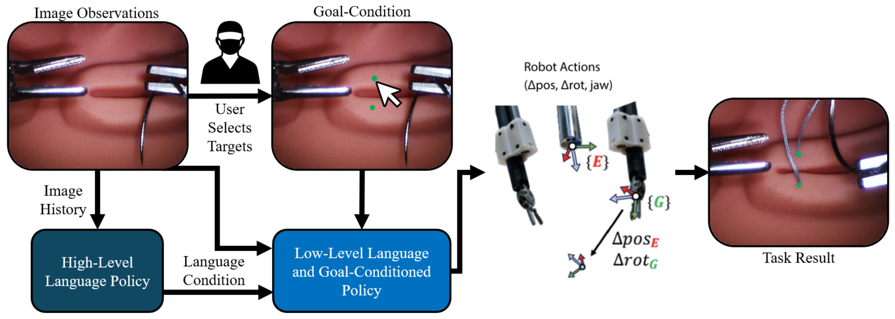
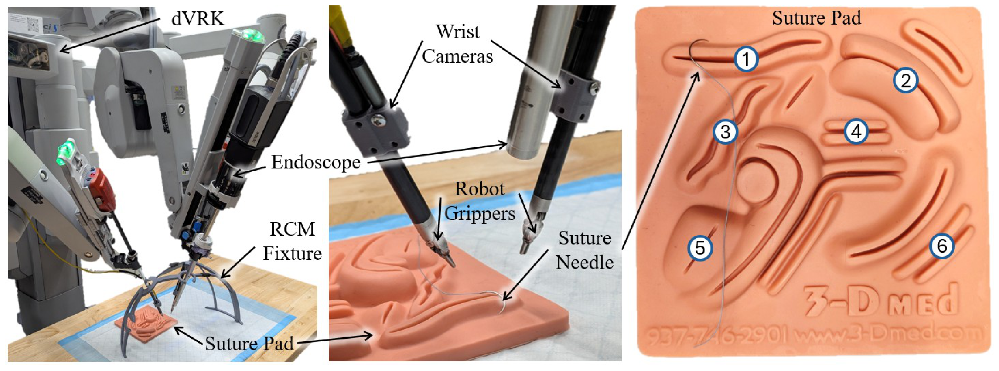
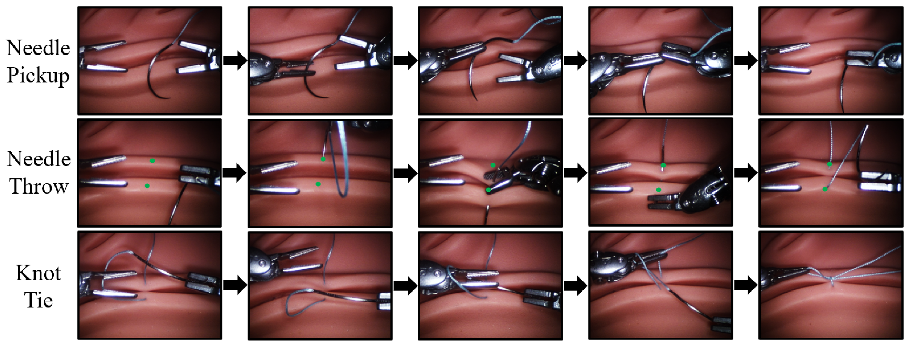
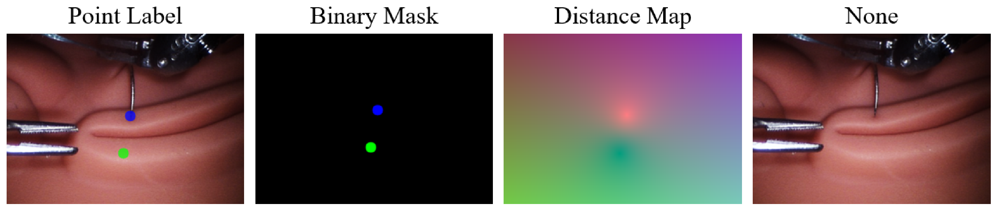
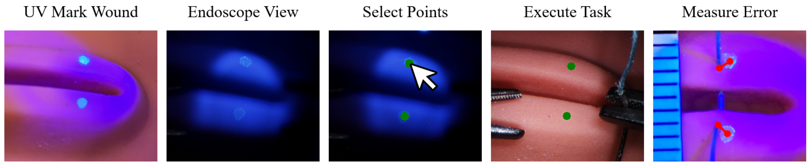
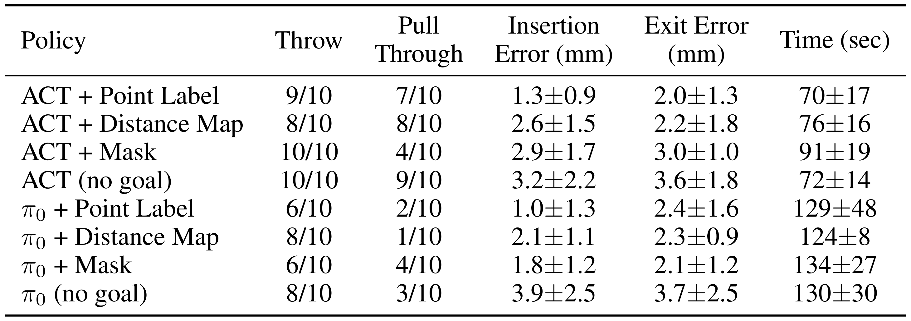
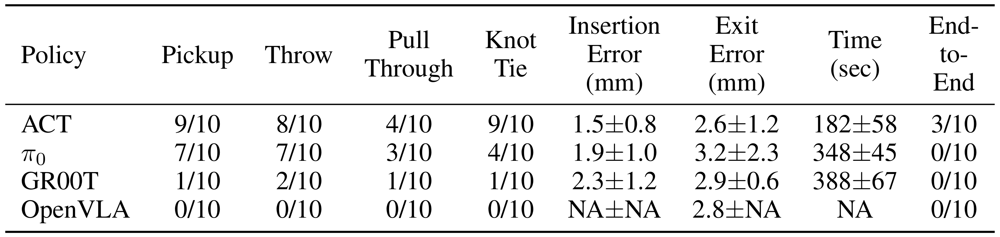
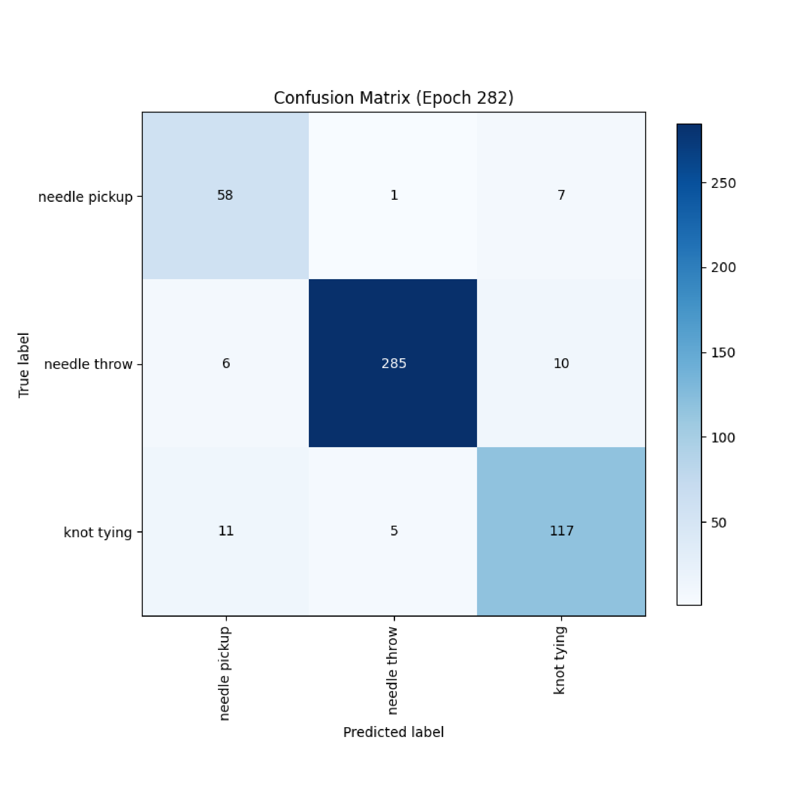
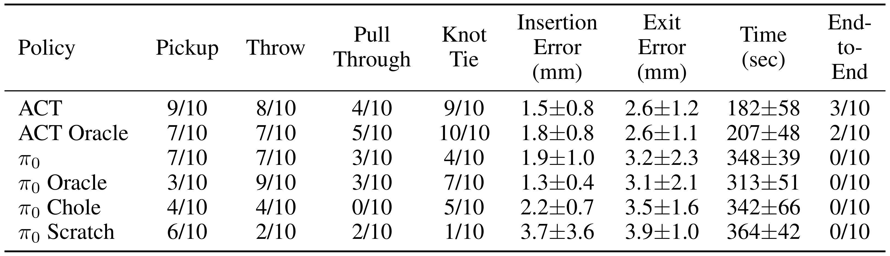
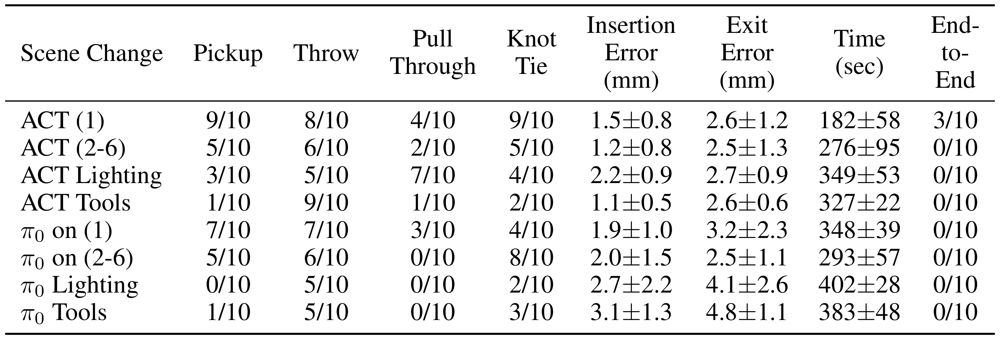

## Summary

SutureBot은 da Vinci Research Kit(dVRK)에서 바늘 집기, 조직 통과, 매듭 묶기로 이어지는 봉합 전 과정을 모방학습(imitation learning) 정책으로 자율 수행하게 하는 벤치마크다. 저자들은 실제 로봇 시연 1,890개를 공개하고, 사용자가 지정한 삽입·배출 지점을 정책 입력으로 넣는 목표 조건(goal condition) 방식으로 삽입 정확도를 높이며, 최신 vision-language-action(VLA) 모델들을 같은 계층 구조 위에서 비교한다.

- **장기 과제 봉합 벤치마크**
  - 자율 봉합의 진척을 추적할 벤치마크가 없던 상황에서, 바늘 집기, 바늘 통과, 매듭 묶기 세 과제로 나눈 봉합 전 과정을 실제 dVRK에서 평가하고, 과제 성공률과 함께 밀리미터 단위의 삽입·배출 오차를 재는 재현 가능한 정밀도 지표를 제시한다는 주장

- **최대 규모의 실제 봉합 데이터셋**
  - 실패 상태에서 시작하는 복구 시연 454개를 포함한 1,890개의 dVRK 시연을 내시경 스테레오 영상, 손목 카메라 두 대, 기구학 데이터와 함께 공개

- **정밀도를 겨냥한 목표 조건 모방학습**
  - 목표 지점을 내시경 영상에 점으로 표시해 정책에 넣는 방식으로, 목표 조건이 없는 정책 대비 삽입 정확도를 59~74% 개선했다는 주장

- **최신 VLA 모델의 기준 성능**
  - π0, GR00T N1, OpenVLA-OFT, 다중 과제 ACT를 같은 고수준 과제 예측 정책과 결합해 평가하고, 사전학습 체크포인트와 장면 변화에 따른 성능을 기준선으로 제시

## Background

봉합(suturing)은 바늘을 정확한 위치에 찔러 넣고, 변형되는 조직 속에서 바늘을 돌려 반대편으로 빼낸 뒤, 실을 감아 매듭을 짓는 일련의 동작이다. 한 단계의 작은 오차가 다음 단계의 실패로 이어지는 장기(long-horizon) 과제이면서, 바늘을 어디에 찌르는지가 임상적 의미를 갖는 정밀 과제이기도 하다. 저자들은 개별 단계의 자동화는 많이 시도되었지만, 실제 로봇에서 봉합 전 과정을 처음부터 끝까지 자율로 수행한 사례는 아직 없다고 본다.

- **① 모델 기반 자율 봉합 (STAR, SNAP, STITCH, MPC)**
  - **방식**: 정교한 컴퓨터 비전, 전용 봉합 도구나 기계적 바늘 가이드, 순차 볼록 최적화, 모델 예측 제어로 봉합 동작을 계획
  - **한계**: 정밀도는 높지만 일반화와 오류 복구가 어렵고, 예측하기 어려운 조직 상호작용에 대응하려면 광범위한 모델링이 필요. 바늘 집기와 매듭까지 포함한 전 과정 시연은 없음

- **② 단일 과제 모방학습 (ACT, π0, SRT, 바늘 집기·전달·추출 연구)**
  - **방식**: 사람의 시연에서 행동을 직접 학습하며, ACT는 행동 묶음(action chunk) 예측으로 누적 오차를 줄이고 π0는 사전학습 VLM과 flow matching 행동 전문가로 연속 행동을 생성
  - **한계**: 개별 단계에서는 높은 성공률을 보이지만, 장기 순서 조율과 봉합에 필요한 위치 정밀도는 다루지 않음

- **③ 계층형 장기 정책 (SRT-H, SurgicAI, π0.5)**
  - **방식**: 고수준 정책이 현재 하위 과제를 언어로 지정하고 저수준 정책이 이를 수행하거나, 대규모 다중 모달 데이터로 장기 행동을 학습
  - **한계**: SRT-H의 담낭절제술은 봉합보다 덜 정교한 과제이고, SurgicAI의 전 과정 봉합은 시뮬레이션에서만 시연됨. π0.5 같은 범용 정책은 100만 개 이상의 궤적으로 학습되어 봉합에는 그만한 데이터가 없음

- **④ 목표 조건 정책 (RoboPoint, AimBot)**
  - **방식**: 영상 위에 목표 지점이나 보조 시각 단서를 표시해 정책의 공간 인식을 돕고 과제 성공률을 높임
  - **한계**: 성공률 향상에는 쓰였지만, 정책이 지정한 지점에 얼마나 정확히 도달하는지를 측정하는 정밀 제어 용도로는 검증되지 않음

- **⑤ 수술 로봇 데이터셋과 평가 (JIGSAWS, SurgicAI, dVRK 탁상 과제 데이터셋)**
  - **방식**: dVRK로 수집한 시연 영상과 기구학 데이터를 공개
  - **한계**: 공개된 dVRK 데이터셋은 수백 개 규모이고 봉합 전 과정 데이터는 모두 합쳐도 200개 미만. 진척을 추적할 표준 벤치마크가 없고, 평가가 과제 완료 여부라는 거친 지표에 머묾

다섯 계열은 각각 정밀도(①), 단일 단계의 학습(②), 장기 순서(③), 목표 지정(④)을 따로 해결했지만 한 시스템 안에서 결합되지 않았다. 최근 모방학습 구조가 장기 과제를 풀 수 있게 된 것도 대규모 데이터 덕분인데, 봉합에는 그 데이터와 함께 정밀도를 재는 공통 평가 틀이 없다. 저자들이 제기하는 문제는 실제 수술 로봇에서 봉합 전 과정을 학습하고 평가할 데이터, 정밀도 지표, 기준 정책이 동시에 비어 있다는 것이다.

## Method

SutureBot의 정책은 두 층으로 나뉜다. 고수준 정책은 최근 영상만 보고 지금이 바늘 집기, 바늘 통과, 매듭 묶기 중 어느 단계인지 판단해 그 단계를 지시하는 언어 명령을 만든다. 저수준 정책은 이 명령, 최신 손목·내시경 영상, 로봇 기구학, 그리고 목표 조건을 받아 여러 시점의 상대 행동을 한 묶음(action chunk)으로 출력한다. 하나의 저수준 정책이 언어 명령에 따라 세 과제를 모두 수행하므로, 과제마다 정책을 따로 두던 이전 방식(SRT)과 달리 과제 사이를 끊지 않고 이어 갈 수 있다는 것이 저자들의 설명이다.

이 논문에서 이해가 가장 어려운 부분은 목표 조건이 어떻게 학습되는가다. 목표는 시연 중에 주어지는 것이 아니라 수집이 끝난 뒤에 붙는다. 각 바늘 통과 시연의 마지막 프레임에서 실제로 바늘이 들어간 지점과 나온 지점을 사람이 GUI로 표시하고, 이 사후 표시를 그 시연의 목표로 쓴다. 따라서 학습 데이터 안에서는 영상에 표시된 점과 실제 바늘 경로가 항상 일치하고, 정책은 표시된 점과 바늘을 찔러 넣는 위치 사이의 대응을 배운다. 시험 때는 사용자가 GUI에서 삽입·배출 지점을 고른다. 목표 조건이 없는 정책은 학습 데이터에서 자주 나타난 삽입 위치를 재현할 뿐이므로, 그 정책의 오차는 지정 지점과 학습 분포 사이의 거리를 나타내는 기준선이 된다.

이 구성은 Background의 한계에 대응한다. 모델 기반 방법의 일반화·복구 한계(①)에는 시연에서 직접 배우는 모방학습과, 실패 상태에서 시작해 회복하는 복구 시연으로 대응한다. 단일 과제 정책의 장기 순서 문제(②)와 계층형 정책의 실제 봉합 부재(③)에는 고수준 과제 예측과 언어 조건 다중 과제 저수준 정책을 실제 dVRK 봉합 전 과정에 적용하는 방식으로 대응한다. 목표 조건이 정밀 제어로 검증되지 않은 문제(④)에는 지정 지점을 정책 입력으로 넣고 실제 오차를 밀리미터로 재는 방식으로, 데이터와 평가 부재(⑤)에는 1,890개 시연과 자외선 표식 기반 정밀도 측정으로 대응한다.

_Figure 1. 정밀도 조건 계층 제어 구조_

### Dataset and Task Description

데이터는 dVRK Si 버전, 3-D Med 봉합 패드, 3-0 Ethibond 봉합사로 수집했다. 3D 프린팅한 trocar 고정틀이 원격 운동 중심(remote center of motion, RCM)을 고정하고, 손목 카메라 거치대와 함께 STL 파일로 공개된다. 왼팔에는 DeBakey forceps, 오른팔에는 large needle driver를 달았다. 모든 시연은 패드의 1번 상처에서 수집하고, 2~6번 상처는 일반화 시험에만 쓴다.

{: w="705" }
_Figure 2. dVRK 실험 구성과 봉합 패드의 상처 번호_

봉합은 SRT의 분해를 따라 세 과제로 나눈다. 바늘 집기에서는 왼쪽 집게가 바늘 끝 근처를 잡아 오른쪽 집게에 넘기고, 바늘 통과에서는 오른쪽 집게가 상처의 뒷벽과 앞벽을 차례로 관통시킨 뒤 바늘을 놓고 실을 다시 잡아 끌어낸다. 매듭 묶기에서는 오른쪽 집게가 실을 왼쪽 집게에 시계 방향으로 감고, 왼쪽 집게가 느슨한 끝을 잡아 양쪽으로 당긴다.

{: w="553" }
_Figure 3. 바늘 집기, 바늘 통과, 매듭 묶기_

시연은 바늘 집기 628개(복구 148), 바늘 통과 310개(복구 96), 매듭 묶기 952개(복구 210)다. 복구 시연은 DAgger에서 착안해, 초기 정책을 실제로 돌려 흔한 실패 상태를 찾은 뒤 그 상태에서 시작해 과제를 마치는 시연을 추가로 모은 것이다. 각 시연에는 양팔 말단의 6자유도 자세, 집게 개폐 각도, 목표 자세와 관절각, RCM 자세가 30Hz로 기록되고, 내시경 스테레오 영상(960×540)과 손목 카메라 영상(640×480)이 같은 주기로 동기화된다. 관절 구성, RCM 위치, 패드 배치와 방향, 바늘 초기 자세, 손목 카메라 거치 상태에 변화를 주어 장면 다양성을 확보한다.

### Policy Architecture

고수준 정책은 ImageNet으로 초기화한 Swin-T가 내시경 영상의 최근 4프레임(30프레임 간격)을 토큰으로 인코딩하고, transformer decoder가 현재 하위 과제의 언어 명령을 생성한다. 저수준 정책으로는 π0, GR00T N1, OpenVLA-OFT 세 VLA와, 사전학습 VLM 없이 DistilBERT 언어 인코더와 FiLM 조건을 쓰는 다중 과제 ACT를 비교한다. π0와 GR00T N1은 flow matching 행동 head를 쓰고, OpenVLA-OFT는 병렬 디코딩과 L1 회귀로 행동을 예측한다. Diffusion Policy도 같은 언어 조건 방식으로 시도했지만 구현에서 납득할 만한 성능을 얻지 못해 비교에서 제외했다.

과제마다 일반 시연 2개와 복구 시연 2개씩, 모두 12개를 평가용으로 떼어 둔다. L1 회귀를 쓰는 ACT와 OpenVLA-OFT는 1만 단계 이상 학습하고, MSE를 쓰는 π0와 GR00T N1은 과적합 경향 때문에 훨씬 적은 단계만 학습한다. 최종 체크포인트는 과적합이 관찰되기 전의 최저 평가 손실 시점으로 고른다.

### Goal Representations

목표 지점을 정책에 넣는 형식은 세 가지를 비교한다. Point label은 내시경 영상 위의 삽입 지점에 파란 점, 배출 지점에 초록 점을 불투명하게 직접 그린다. Binary mask는 두 번째 채널이 삽입 마스크, 세 번째 채널이 배출 마스크인 3채널 영상이다. Distance map은 앞의 두 채널에 삽입 지점을 향하는 정규화된 픽셀 오프셋 $(dx, dy)$를, 세 번째 채널에 삽입 지점에서 가장 밝고 배출 지점에서 가장 어두운 열지도를 넣는다. Mask와 distance map은 별도 영상 입력으로 들어가고, point label만 원래 영상을 바꾼다. 여기에 목표 조건이 없는 정책을 기준선으로 둔다.

{: w="574" }
_Figure 4. 목표 조건 형식_

### Metrics

과제 성공은 시간 제한 안의 동작 완료로 판정한다. 바늘 집기는 왼쪽 집게가 바늘을 잡고 오른쪽 집게가 이어받으면 성공이다. 바늘 통과는 평가에서 두 하위 과제로 나누어, 바늘이 뒷벽과 앞벽을 관통하면 throw 성공, 바늘을 조직에서 빼내 원위치로 돌아오면 pull through 성공이다. 매듭은 실을 시계 방향으로 감고 느슨한 끝을 고리 사이로 단단히 당기면 성공이다. 시간 제한은 pull through가 60초, 나머지는 120초이며, 전체 시간은 성공한 과제의 실제 시간과 실패한 과제의 제한 시간을 더해 계산한다.

정밀도는 자외선(UV) 표식으로 잰다. 실행 전에 패드의 목표 삽입·배출 지점을 UV 펜으로 표시하고, UV 조명 아래 내시경 영상에서 그 지점을 골라 목표 조건을 만든다. 실행 중에는 조명을 꺼 정책이 표식을 볼 수 없게 하고, 실행 후 다시 비춰 ImageJ로 표식과 실제 봉합사 통과 지점 사이의 유클리드 거리를 잰다. 바늘 통과가 실패해도 한 번이라도 관통했으면 그 관통 지점의 오차는 포함한다.

{: w="726" }
_Figure 5. UV 표식으로 삽입·배출 오차를 재는 절차_

## Experiments

모든 정책은 같은 로봇 구성과 패드 배치에서 바늘 위치만 바꿔 가며 봉합 전 과정을 10회씩 수행한다. 한 과제가 실패하면 다음 과제 전에 사람이 상태를 재설정하므로, 과제별 성공률과 함께 사람의 개입 없이 전 과정을 마친 end-to-end 성공을 따로 센다. 학습은 A100 8장, 평가는 RTX 4090 두 장에서 한다.

{: w="490" }
_Table 1. 목표 조건 형식별 바늘 통과 성공률과 정밀도_

- **목표 조건 형식의 선택**
  - **목적**: 어떤 목표 표현이 바늘 삽입 정밀도를 가장 높이는지 확인
  - Table 1에서 ACT와 π0 모두 목표 조건을 넣은 변형이 목표 조건 없는 기준선보다 삽입 오차가 작고, point label이 두 정책 모두에서 가장 작은 평균 삽입 오차를 낸다는 결과. 저자들은 Bonferroni 보정 검정으로 point label이 다른 형식이나 기준선보다 정확도(평균 오차)와 정밀도(분산)에서 유의하게 나은 비교들을 보고하고, 이후 모든 평가에 point label을 채택
  - point label 정책은 목표에 다가가며 바늘을 조심스럽게 맞추는 머뭇거리는 동작을 보이고, mask와 distance map 정책은 더 빨리 끝내지만 덜 정확하다는 관찰. 저자들은 별도 입력을 내시경 영상과 통합해야 하는 부담 때문이며, point label은 목표를 과제 영상 안에 직접 넣어 더 명시적이라고 해석
  - 배출 오차는 기준선을 뺀 형식들 사이에서 비슷하다는 결과. 저자들은 모든 정책에 과거 문맥이 없어 바늘이 조직 속에 가려졌을 때 불확실성이 커지고, 배출 지점이 삽입 위치와 각도에 크게 묶이기 때문이라고 설명

{: w="537" }
_Table 2. 저수준 정책별 과제 성공률, 정밀도, 시간_

- **저수준 정책 비교**
  - **목적**: 최신 모방학습 정책들이 SutureBot 벤치마크에서 어느 수준인지 확인
  - Table 2에서 개별 과제 성공률은 ACT가 가장 높고 π0가 뒤를 이으며, 사람의 개입 없이 전 과정을 마친 시도는 ACT에서만 나온다는 결과. 삽입 오차도 ACT가 가장 작고 π0가 근접. GR00T N1과 OpenVLA-OFT는 대부분의 과제에서 실패
  - 저자들은 카이제곱 검정과 사후 Fisher 검정으로 ACT가 GR00T N1과 OpenVLA-OFT보다 유의하게 낫지만 π0와의 차이는 유의 수준에 이르지 않는다고 보고
  - ACT의 우위는 작고 균일한 데이터셋에서 작은 정책이 유리하기 때문이고, dVRK와 봉합 과제가 π0의 사전학습 분포와 크게 달라 사전학습 이점이 제한된다는 해석. π0가 GR00T N1보다 나은 것은 구조가 비슷한 가운데 π0의 사전학습이 dVRK와 닮은 양팔 조작기에 집중되었기 때문이며, GR00T N1은 자유도가 많은 휴머노이드 중심이라는 설명

{: w="726" }
_Figure 6. 고수준 정책의 검증 데이터 혼동 행렬_

- **고수준 정책의 과제 예측**
  - **목적**: 고수준 정책이 현재 하위 과제를 정확히 판별하는지 오프라인으로 확인
  - Figure 6의 혼동 행렬에서 세 과제 대부분이 대각선에 놓이고, 저자들은 과제 예측의 F1과 정확도가 높으며 과제 전환 감지는 완벽했다고 보고. 이를 전체 절차를 하위 과제로 안정적으로 나눈다는 근거로 제시

{: w="547" }
_Table 3. π0 사전학습 체크포인트와 고수준 정책 oracle 비교_

- **고수준 정책이 병목인지 여부**
  - **목적**: 고수준 정책 대신 사람이 언어 명령을 줄 때 성능이 달라지는지 확인
  - Table 3에서 ACT Oracle과 π0 Oracle이 각각 고수준 정책을 쓴 ACT, π0와 비슷한 성공률, 시간, 정밀도를 보인다는 결과. 저자들은 고수준 정책이 사람 수준으로 저수준 정책을 지휘하며 성능 병목이 아니라고 결론

- **사전학습의 효과**
  - **목적**: VLA의 사전학습 데이터가 봉합 성능에 얼마나 기여하는지 확인
  - Table 3에서 공개 π0 체크포인트와, SRT-H의 담낭절제술 위주 궤적으로 추가 학습한 π0 Chole이 비슷한 과제 성공률을 보이고, 삽입 오차는 공개 체크포인트가 약간 낫다는 결과. 저자들은 사전학습 구성에 따른 도메인 내 이점이 뚜렷이 구분되지 않는다고 서술
  - PaliGemma에서 시작한 π0 Scratch의 성능 하락이 작다고 보고, 이 과제와 embodiment가 π0 사전학습과 달라 그 이점이 제한된다는 주장의 근거로 사용. 사전학습은 수렴 시간을 줄여, π0 Chole이 가장 빨리 수렴하고 π0 Scratch가 가장 오래 걸렸다는 서술

{: w="555" }
_Table 4. 처음 보는 상처, 조명, 도구에서의 성능_

- **장면 변화에 대한 일반화**
  - **목적**: 학습에 없던 상처 형상, 조명, 도구 배치에서 상위 두 정책이 유지되는지 확인
  - Table 4에서 π0는 처음 보는 상처(2~6번)에서도 학습한 상처와 매우 비슷한 성능을 내고, ACT는 눈에 띄게 하락한다는 결과. 저자들은 이를 두께와 형상이 다른 상처에 대한 VLA의 일반화 능력으로 해석
  - 측면의 어두운 조명과 좌우 도구를 바꾼 조건에서는 두 정책 모두 성공률이 더 떨어진다는 결과. 저자들은 단순한 데이터셋에서도 어느 정도 일반화가 나타나지만, 환경 변화가 큰 수술 응용에는 다양한 데이터가 중요하다고 주장

## Limitations & Thoughts

- **"정밀도 59~74% 개선"이 의미하는 범위**
  - 이 논문에서 가장 과대평가되기 쉬운 주장이다. 이 수치는 Table 1의 삽입 오차(ACT 3.2에서 1.3mm, π0 3.9에서 1.0mm)에서만 나온다. 배출 오차의 개선은 ACT 44%(3.6에서 2.0mm), π0 35%(3.7에서 2.4mm)로 더 작다
  - 정밀도가 오른 대신 성공률은 내려간다. ACT는 point label에서 pull through가 9/10에서 7/10으로, π0는 throw가 8/10에서 6/10으로 줄었다. 오차는 실패한 throw의 관통 지점도 포함하므로, 끝까지 성공한 봉합만의 정밀도와는 다르다
  - 목표 조건 없는 기준선의 오차는 시험 목표가 학습 분포에서 얼마나 떨어져 있느냐에 좌우되는데, 시험 목표를 어떤 규칙으로 골랐는지 서술이 없다. 목표가 학습 분포의 중심에서 멀수록 개선 폭은 커진다. π0 point label의 1.0±1.3mm처럼 표준편차가 평균보다 큰 10회 측정에서 비율 개선을 한 숫자로 요약하는 것도 불안정하다

- **벤치마크로서의 재현성**
  - "재현 가능한 벤치마크"라는 주장에 비해 프로토콜이 느슨하다. 시험 목표 지점 선택 규칙, 바늘 초기 위치의 분포, 실패 시 재설정 상태가 표준화되어 있지 않고, 오차 측정도 ImageJ 수작업이다. 같은 장비를 가진 다른 연구실이 같은 숫자를 낼 수 있는지는 이 서술만으로 보장되지 않음
  - 학습 데이터는 한 종류의 패드, 한 개의 상처에서 나왔다. 2~6번 상처 평가는 10회를 다섯 상처에 나누므로 상처당 약 2회다

- **저수준 정책 비교의 공정성**
  - 부록의 학습 설정을 보면 적응 방식이 크게 다르다. π0는 전체 fine-tuning 7,500단계, ACT는 배치 256으로 1만 단계인 반면, OpenVLA-OFT는 LoRA(rank 32)와 배치 32, GR00T N1은 LLM을 고정한 채 15Hz로 내려 받은 데이터로 3,000단계만 학습했다. 체크포인트는 시연 12개의 평가 손실로 골랐는데, 열린 루프 손실은 닫힌 루프 성공률의 약한 대리 지표다
  - OpenVLA-OFT가 모든 과제에서 0/10이고 Diffusion Policy는 구현 문제로 빠진 것을 보면, Table 2는 모델의 능력보다 이 적응 방식의 성패를 함께 보여 준다. "작은 균일 데이터에서는 ACT가 유리하다"는 해석은 가능한 설명 중 하나일 뿐 통제된 비교로 검증되지 않음

- **10회 시행의 통계적 한계**
  - 저자들도 시행 수가 적다고 인정하지만, 본문 해석은 그보다 단정적이다. Table 4에서 ACT의 처음 보는 상처 삽입 오차(1.2mm)가 학습한 상처(1.5mm)보다 작고, ACT의 조명 변경 조건 pull through(7/10)가 원래 조건(4/10)보다 높다. 이 정도의 역전이 흔한 표본 크기에서 "π0는 매우 비슷하고 ACT는 하락한다"는 결론은 약하다. π0도 처음 보는 상처에서 pull through는 3/10에서 0/10으로, 매듭은 4/10에서 8/10으로 엇갈림
  - 4×2 카이제곱 검정은 모델별 성공·실패를 과제에 걸쳐 합친 것으로 보이는데, 그렇다면 같은 봉합 시도 안의 네 과제를 독립 시행처럼 다룬 것이다. 실패 후 사람이 재설정하므로 과제 간 의존은 줄지만, 같은 시도 안의 장면과 실 상태는 공유됨

- **사전학습 효과에 대한 서술**
  - 저자들은 π0 Scratch의 하락이 "작다"고 쓰지만, Table 3에서 throw는 7/10에서 2/10, 매듭은 4/10에서 1/10, 삽입 오차는 1.9±1.0에서 3.7±3.6mm로 나빠졌다. 사전학습의 기여가 작다는 결론보다는, 공개 사전학습이 이 과제에서 의미 있게 기여한다는 쪽에 가까운 결과다
  - 반대로 수술 영상으로 추가 학습한 π0 Chole이 pull through 0/10으로 공개 체크포인트보다 못하다. 담낭절제술 궤적이 봉합으로 옮겨 가지 않는다는 점은 수술 로봇 사전학습 데이터를 어떻게 구성할지에 대한 중요한 관찰인데, 시행 수가 적어 더 이상의 결론은 어려움

- **고수준 정책 평가의 수치**
  - 본문은 오프라인 과제 예측을 F1 0.92, 정확도 88.73%로 보고하지만, Figure 6의 혼동 행렬로 계산하면 정확도는 460/500인 92.0%, macro F1은 약 0.887이다. 두 수치가 뒤바뀐 것으로 보인다
  - oracle 비교에서 사람이 명령한 π0 Oracle의 바늘 집기(3/10)가 고수준 정책을 쓴 π0(7/10)보다 낮고, ACT Oracle의 end-to-end(2/10)도 ACT(3/10)보다 낮다. 사람이 상한이어야 할 비교에서 이런 역전이 나오는 것은 시행 간 변동이 비교하려는 효과보다 크다는 뜻이다. 고수준 정책을 단독으로 온라인 평가한 실험이 없다는 점은 저자들도 한계로 듦
  - 이 밖에 π0의 시간이 Table 2에서 348±45초, Table 3과 Table 4에서 348±39초로 다름

- **지금 시점에서 보는 위치**
  - SutureBot의 가치는 정책보다 데이터와 측정 방법에 있다. 실제 dVRK 봉합 전 과정 시연 1,890개와, 실행 중에 보이지 않는 UV 표식으로 밀리미터 오차를 재는 방법은 이후 연구가 그대로 가져다 쓸 수 있는 자산이다. 이후 Hugging Face에 공개된 SutureBot2 데이터셋(카드 기준 껍질 있는 돼지 뱃살 ex vivo 상처 봉합 시연 20시간, CoRL 2026 투고 논문과 연결)이 실제 조직으로의 확장을 이어 간다
  - 안전 계보에서 보면, 가장 좋은 정책도 end-to-end 성공이 3/10이고 실패 시 사람이 재설정한다는 사실이 핵심이다. 복구 시연이 실패 상태를 학습에 넣는 데이터 측 대응이라면, [FoMo-FD](/paper-review/posts/2607.27511/) 같은 실행 중 실패 감지는 정책이 실패 상태에 들어가는 순간을 잡아 사람에게 넘기는 시스템 측 대응이다. SutureBot의 과제별 실패 분포는 이런 감지기를 평가할 실제 데이터가 될 수 있음

---

이 시리즈의 다른 글: [surgical-robot-safety](/paper-review/categories/surgical-robot-safety/)

> 원문: [arxiv.org/abs/2510.20965](https://arxiv.org/abs/2510.20965) · 그림·표 출처: 원문 (CC BY 4.0)
