## Summary

SurgMotion은 V-JEPA의 latent 마스킹 예측을 수술 영상에 맞게 고친 영상 파운데이션 모델이다. 움직임이 큰 영역을 강조하는 예측 손실, 가려진 토큰들 사이의 관계 구조를 맞추는 자기증류, 특징 붕괴를 막는 분산 정규화를 더하고, 50개 출처 3,658시간의 수술 영상 SurgMotion-15M으로 사전학습한 뒤 인코더를 고정한 채 17개 벤치마크에서 평가한다.

- **Motion-guided latent masked prediction**
  - 픽셀 복원 대신 latent 공간에서 가려진 영역을 예측하고, 픽셀 공간의 시공간 기울기로 계산한 움직임 점수로 예측 손실의 가중치를 다시 매김. 연기, 반사광 같은 저수준 외형 대신 도구와 조직 상호작용에 용량을 쓰게 한다는 주장

- **Spatiotemporal affinity self-distillation**
  - 가려진 토큰들 사이의 유사도 분포(affinity)를 EMA 교사 네트워크의 분포와 KL divergence로 맞춰, 라벨 없이 시공간 관계의 일관성을 부과한다는 주장

- **Spatiotemporal feature diversity regularization (SFDR)**
  - 예측된 latent의 차원별 표준편차가 기준값 아래로 떨어지지 않게 해, 질감이 단조로운 수술 장면에서 표현 붕괴와 채널 중복을 줄인다는 주장

- **SurgMotion-15M 데이터셋**
  - 12개 전문 분야, 13개 장기, 50개 출처의 3,658시간 영상을 모은 당시 최대 규모의 수술 영상 사전학습 코퍼스. 이 규모와 다양성이 시술과 기관을 넘는 일반화를 가능하게 한다는 주장

## Background

수술 영상 파운데이션 모델은 라벨 없는 대규모 영상으로 범용 표현을 먼저 학습하고, 단계 인식, triplet 인식, 분할 같은 하류 과제에는 가벼운 head만 얹는 방식이다. 저자들은 기존 모델이 두 가지 측면에서 막혀 있다고 본다. 하나는 학습 목표다. 수술 영상의 의미는 도구와 조직이 맞닿는 짧은 움직임에 드물게 몰려 있는데, 픽셀을 복원하는 목표는 연기, 반사광, 체액의 흔들림처럼 맥락으로 예측할 수 없는 고주파 세부를 맞히는 데 용량을 쓴다. 또 지방 조직이나 매끈한 장기 표면처럼 질감이 단조로운 영역이 많아 자기지도 학습에서 특징의 분산이 작아지고 채널이 중복되기 쉽고, 시간에 걸친 관계를 안정시키는 명시적 제약이 없어 시점이나 움직임이 크게 바뀔 때 특징이 흔들린다. 다른 하나는 데이터다. 기존 모델과 벤치마크는 대부분 담낭절제술이나 뇌하수체 수술처럼 한 종류의 시술에 묶여 있다.

- **① 픽셀 복원 기반 범용 영상 모델 (MAE, VideoMAE, VideoMAE V2, InternVideo)**
  - **방식**: 이미지 패치나 시공간 큐브를 가린 뒤 픽셀을 복원하도록 학습하고, InternVideo는 여기에 영상–텍스트 대조 학습을 결합해 수십억 파라미터로 확장
  - **한계**: 확률적이거나 맥락으로 예측할 수 없는 고주파 세부까지 맞혀야 하며, 연기와 반사광이 많은 수술 영상에서 이 문제가 커짐

- **② Latent 예측과 교사–학생 구조 (DINO, DINOv2, DINOv3, BYOL, V-JEPA)**
  - **방식**: 픽셀 대신 표현 공간에서 예측하고, EMA로 갱신되는 교사 네트워크로 붕괴를 막음. V-JEPA는 가려진 시공간 영역의 latent를 예측해 장기 시간 동역학을 포착
  - **한계**: latent 예측의 핵심 난제는 자명한 해로 무너지는 표현 붕괴이며, 수술 영상 고유의 문제(드문 움직임 의미, 단조로운 질감)에 맞춘 설계는 없음

- **③ 이미지 기반 수술 파운데이션 모델 (EndoViT, GastroNet)**
  - **방식**: Endo700k, 500만 장 규모의 위장관 내시경 이미지 등으로 마스킹 이미지 모델링이나 이미지 사전학습을 수행
  - **한계**: 정지 프레임만 보므로 수술 과정 이해의 중심인 시간 동역학을 원천적으로 무시

- **④ 영상 기반 수술 파운데이션 모델 (EndoFM, EndoSSL, EndoMamba, GSViT, SurgeNetXL, SurgVLP, SelfSupSurg)**
  - **방식**: 내시경·수술 영상으로 마스킹 복원, Masked Siamese Network, 상태공간 모델, 다음 프레임 예측, DINO 기반 학습, 강의 영상 텍스트 정렬 등을 수행
  - **한계**: 대부분이 픽셀 수준 복원 목표에 의존해 예측할 수 없는 시각 잡음에 용량을 낭비

- **⑤ 수술 영상 데이터셋 (Cholec80, CholecT50, AutoLaparo, PitVis, OphNet, EgoSurgery, JIGSAWS 등)**
  - **방식**: 기관 협력과 윤리 승인, 비식별화, 전문의 주석을 거쳐 특정 시술과 과제별로 구축
  - **한계**: 각 데이터셋이 하나의 기관, 시술, 주석 체계에 묶인 "데이터 사일로"여서 모델이 해부 부위, 시술 방식, 기관을 넘어 일반화하지 못함

다섯 계열을 겹쳐 보면, latent 예측이라는 방향은 이미 범용 영상에서 제시되었지만 수술 영상으로는 넘어오지 않았고, 수술 쪽은 픽셀 복원과 단일 시술 데이터에 머물러 있다. 학습 목표의 문제와 데이터 규모의 문제가 동시에 걸려 있다는 것이 저자들의 진단이며, 저자들이 제기하는 문제는 픽셀 복원을 넘어 움직임 중심의 의미를 학습하고, 시공간 관계를 안정시키며, 단조로운 장면에서도 특징 다양성을 유지하고, 훨씬 넓은 데이터로 확장되는 수술 영상 모델을 어떻게 만드느냐다.

## Method

SurgMotion의 뼈대는 V-JEPA 그대로다. 영상 클립의 일부 공간 위치를 가리고, 온라인 인코더는 보이는 부분만 본다. 예측기는 이 문맥으로 가려진 위치의 latent를 예측하고, EMA로 갱신되는 타깃 인코더가 클립 전체를 보고 만든 latent가 정답이 된다. 정답이 픽셀이 아니라 표현이므로 연기나 반사광처럼 맥락으로 알 수 없는 외형을 복원할 필요가 없다.

저자들이 더한 세 손실은 모두 예측기가 내놓은 "가려진 토큰들의 예측값"에 작용하지만 보는 관점이 다르다. 첫째 손실은 어디를 더 중요하게 맞힐지를 정한다. 각 위치의 픽셀이 시간에 따라 얼마나 변하고 이웃 위치와 얼마나 다른지로 움직임 점수를 매기고, 가려진 위치 가운데 점수가 높은 곳의 예측 오차에 더 큰 가중치를 준다. 이 논문을 이해할 때 놓치기 쉬운 점은 픽셀 정보가 정답이 아니라 가중치로만 쓰인다는 것이다. 무엇을 맞히는지는 latent 타깃이 정하고, 픽셀 움직임은 어느 위치의 오차를 더 무겁게 볼지만 정한다. 둘째 손실은 토큰 하나하나가 아니라 토큰들 사이의 관계를 맞힌다. 가려진 토큰 각각에 대해 다른 가려진 토큰들과의 유사도 분포를 만들고, 학생의 분포가 교사의 분포를 따르게 한다. 개별 오차가 작아도 "어떤 위치들끼리 비슷한가"라는 구조가 어긋나면 벌점을 받는다. 계산을 가려진 토큰들 안으로만 한정해, 수가 많은 보이는 토큰이나 배경 토큰이 관계 구조를 지배하지 않게 한다. 셋째 손실은 배치 전체에서 예측 latent의 각 차원이 충분히 퍼져 있도록 강제해, 비슷한 장면이 반복될 때 모든 예측이 한 점으로 모이는 붕괴를 막는다.

이 구성은 Background의 한계에 각각 대응한다. 픽셀 복원이 예측할 수 없는 세부에 용량을 낭비한다는 한계(①④)에는 V-JEPA의 latent 예측을 가져오고 움직임 가중치로 도구–조직 상호작용 영역을 강조하는 방식으로 대응한다. latent 예측의 붕괴 위험과 단조로운 수술 질감 문제(②)에는 SFDR로, 시간에 걸친 관계를 안정시키는 제약이 없다는 문제에는 affinity 자기증류로 대응한다. 정지 프레임 모델의 시간 정보 부재(③)에는 16프레임과 64프레임 클립을 입력으로 하는 영상 기반 사전학습으로, 데이터 사일로(⑤)에는 12개 전문 분야를 모은 SurgMotion-15M과 분야·데이터셋 균형 샘플링으로 대응한다.

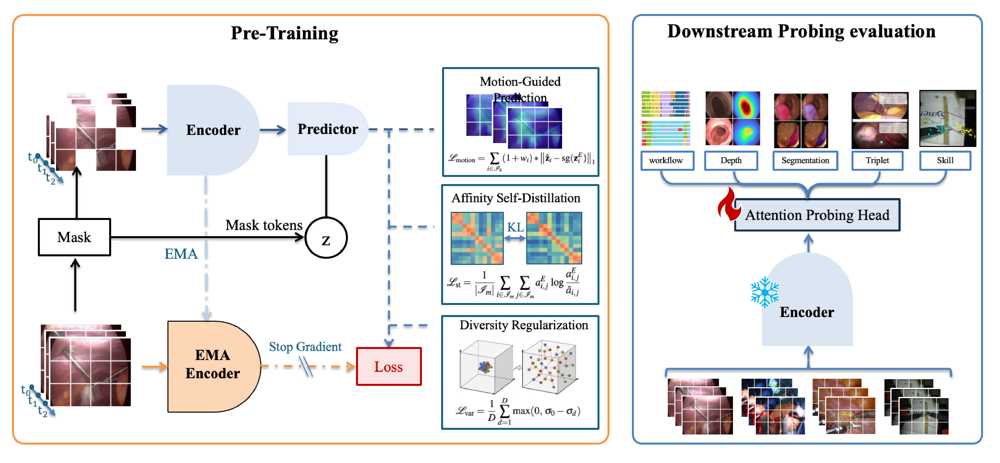
_Figure 2. SurgMotion 사전학습과 하류 probing 평가_

### The SurgMotion-15M Dataset

SurgMotion-15M은 공개 데이터셋과 기관 내부 영상을 모은 다분야 수술 영상 모음이다. 시간 기준으로는 뇌하수체·두개·척추를 포함한 신경외과가 가장 크고, 일반외과(AVOS), 안과(OphNet, CATARACTS), 위 수술(MultiBypass140, CoPESD), 담낭절제술(Cholec80, M2CAI-2016), 대장내시경(EndoFM 데이터), 부인과(AutoLaparo), 비뇨기과(PSI-AVA), 간 절제(PmLR50), 술기 훈련(JIGSAWS, AIxSuture), 기관지 내시경(기관 내부), 유방 수술(EgoSurgery)이 들어간다.

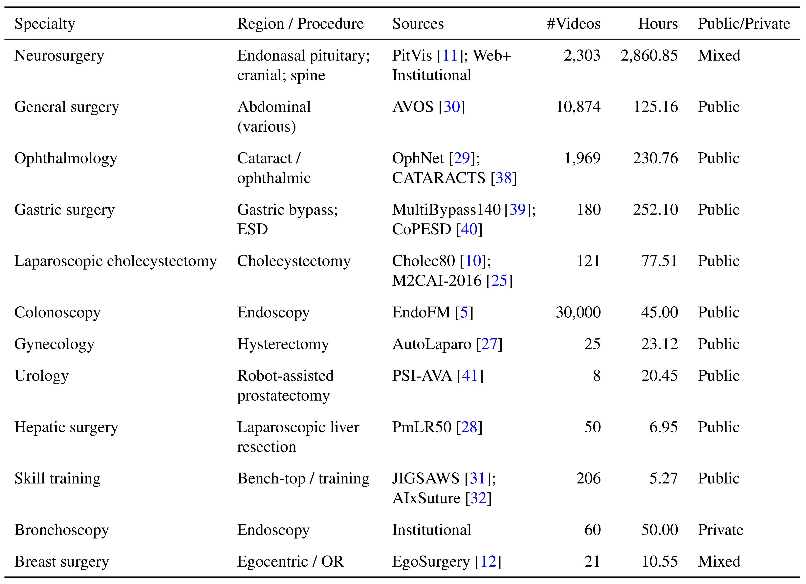{: w="683" }
_Table 1. SurgMotion-15M 데이터 출처와 규모_

출처마다 영상 수와 길이가 크게 다르므로, 전문 분야 $s$에 속한 데이터셋 $d$의 샘플 $x$에 아래 가중치를 주어 분야와 데이터셋마다 샘플링 질량이 같아지게 한다.

$$
w(x) \propto \frac{1}{N_d\,|\mathcal{D}_s|}
$$

$N_d$는 데이터셋 $d$의 샘플 수, $$|\mathcal{D}_s|$$는 분야 $s$에 속한 데이터셋 수다. 모든 영상은 초당 1프레임으로 처리하고, 짧은 변을 256픽셀로 맞춘 뒤 224×224로 무작위 자른다.

### Architecture

클립 $$X \in \mathbb{R}^{T\times H\times W\times C}$$의 각 프레임을 16×16 패치로 나누고, 같은 공간 위치의 패치를 $T$개 프레임에 걸쳐 묶은 것을 튜브(tube)라 부른다. 클립당 튜브 토큰은 $N = \frac{H}{16}\cdot\frac{W}{16}$개이고, 가려진 튜브와 보이는 튜브의 인덱스 집합을 $$\mathcal{I}_m$$, $$\mathcal{I}_v$$로 둔다. 마스킹 비율은 $\rho \sim \mathcal{U}(0.75, 0.95)$에서 뽑는다.

온라인 쪽의 문맥 인코더 $c_\theta$는 보이는 튜브만 인코딩해 $$Z_v = c_\theta(X; \mathcal{I}_v)$$를 만든다. 가려진 튜브 $i$마다 공유 학습 쿼리 $q$와 위치 임베딩 $e_i$를 더한 마스크 토큰 $m_i = q + e_i$를 두고, 예측기 $p_\phi$가 $[Z_v; M_m]$를 받아 가려진 튜브의 예측 latent $$\hat{Z}_m$$을 출력한다. 타깃 쪽의 EMA 인코더 $$c_{\bar\theta}$$는 같은 구조로 클립 전체를 인코딩해 $$Z^E = c_{\bar\theta}(X)$$를 만들고, 모든 타깃에는 stop-gradient $\mathrm{sg}(\cdot)$를 건다. EMA 모멘텀은 0.99925다.

### Training Objectives

움직임 점수 $g_i$는 튜브 $i$의 픽셀 패치 $$x_{t,i}$$가 인접 프레임 사이에서 변하는 정도와, 공간 4-이웃 $\mathcal{N}(i)$과 다른 정도를 더한 값이다.

$$
\begin{aligned}
g_i &= \frac{1}{T-1}\sum_{t=1}^{T-1}\lVert x_{t+1,i}-x_{t,i}\rVert_1 \\
&\quad + \frac{1}{T}\sum_{t=1}^{T}\frac{1}{|\mathcal{N}(i)|}\sum_{j\in\mathcal{N}(i)}\lVert x_{t,i}-x_{t,j}\rVert_1
\end{aligned}
$$

앞의 항은 시간 변화, 뒤의 항은 공간 경계의 세기를 잰다. 가려진 튜브 중 $g_i$ 상위 $K=3$개를 $$\mathcal{I}_h$$로 고르고, $\gamma=2$의 softmax로 가중치를 만든 뒤 가중 L1 회귀를 한다.

$$
w_i = \frac{\exp(\gamma g_i)}{\sum_{k\in\mathcal{I}_h}\exp(\gamma g_k)}
$$

$$
\mathcal{L}_{\text{motion}} = \sum_{i\in\mathcal{I}_h}(1+w_i)\,\big\lVert \hat{z}_i - \mathrm{sg}(z_i^E)\big\rVert_1
$$

affinity 자기증류는 L2 정규화한 예측 $$\hat{u}_i$$와 타깃 $$u_i^E$$로, 가려진 튜브들 사이의 온도 $\tau=0.1$ softmax 유사도 분포를 학생과 교사에서 각각 만들고 KL divergence로 맞춘다.

$$
\hat{a}_{i,j} = \frac{\exp(\hat{u}_i^\top \hat{u}_j/\tau)}{\sum_{k\in\mathcal{I}_m}\exp(\hat{u}_i^\top \hat{u}_k/\tau)}
$$

$$
\mathcal{L}_{\text{st}} = \frac{1}{|\mathcal{I}_m|}\sum_{i\in\mathcal{I}_m}\sum_{j\in\mathcal{I}_m} a^E_{i,j}\log\frac{a^E_{i,j}}{\hat{a}_{i,j}}
$$

$$a^E_{i,j}$$는 같은 식을 타깃 latent로 계산한 분포다. SFDR은 배치 전체에서 모은 예측 latent의 차원별 표준편차 $\sigma_d$가 기준값 $\sigma_0$보다 작을 때만 벌점을 주는 hinge 형태다. 최종 목적 함수는 세 항의 가중합이다.

$$
\mathcal{L}_{\text{var}} = \frac{1}{D}\sum_{d=1}^{D}\max(0,\ \sigma_0 - \sigma_d)
$$

$$
\mathcal{L} = \mathcal{L}_{\text{motion}} + \lambda_{\text{st}}\mathcal{L}_{\text{st}} + \lambda_{\text{var}}\mathcal{L}_{\text{var}}
$$

$$\lambda_{\text{st}}=0.1$$, $$\lambda_{\text{var}}=0.3$$이다. 사전학습은 두 단계로, 1단계는 16프레임 클립으로 200 epoch(학습률 $5\times10^{-4}$, 전역 배치 256), 2단계는 1단계 체크포인트에서 64프레임 클립으로 80 epoch(전역 배치 64)를 이어 간다. 초당 1프레임이므로 각각 16초, 64초 길이의 클립이다. 최적화는 AdamW(weight decay 0.04)와 cosine 학습률 스케줄을 쓰고, H800 GPU 4장에서 학습한다.

## Experiments

DINOv3, VideoMAE 같은 범용 모델과 EndoViT, GastroNet, EndoFM, EndoSSL, EndoMamba, GSViT, SurgeNetXL, SelfSupSurg, SurgVLP 등 13개 파운데이션 모델을 비교한다. 모든 모델의 가중치를 고정하고, V-JEPA 2의 절차대로 attention 블록 4개(cross-attention head 16개)의 attentive probe만 학습한다. 서로 다른 학습 설정의 probe 16개를 동시에 학습해 가장 좋은 결과를 보고하며, 이 절차를 모든 모델에 똑같이 적용한다.

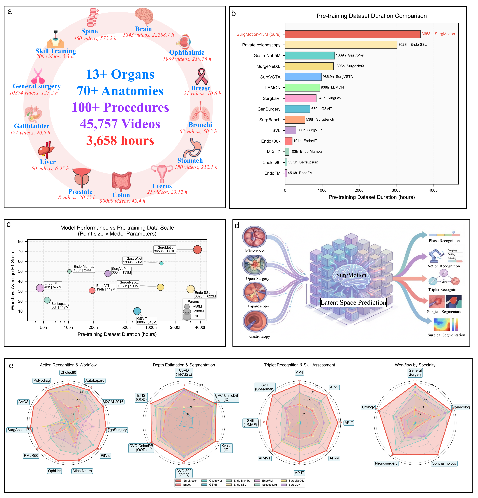
_Figure 1. SurgMotion-15M 구성, 사전학습 데이터 규모 비교, 과제별 요약_

- **사전학습 데이터 규모와 성능**
  - **목적**: 사전학습 데이터의 규모와 다양성이 하류 성능으로 이어지는지 확인
  - Figure 1(a), (b)에서 SurgMotion-15M이 13개 장기에 걸쳐 있으며 기존 수술 모델들의 사전학습 데이터보다 길다는 비교
  - Figure 1(c)에서 사전학습 데이터 시간이 길수록 단계 인식 평균 F1이 높아지는 경향이 나타나고 SurgMotion이 가장 오른쪽 위에 위치한다는 결과. 저자들은 이를 데이터 규모 확대가 단계 인식 성능을 높인다는 근거로 제시
  - Figure 1(e)의 레이더 차트는 과제군과 전문 분야별로 SurgMotion이 모든 축에서 가장 바깥에 있다는 요약

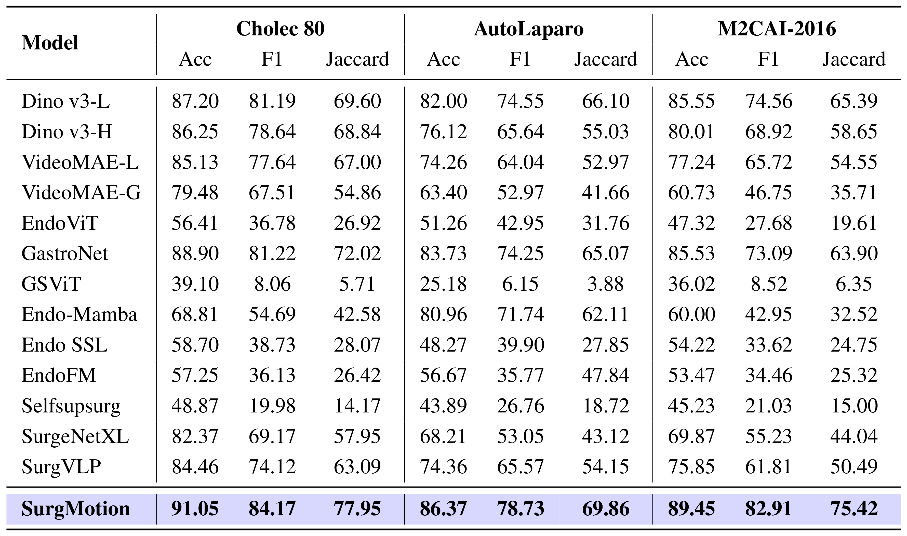{: w="598" }
_Table 2. 복강경 수술 단계 인식_

- **복강경 단계 인식**
  - **목적**: 기존 수술 모델들이 주로 평가된 복강경 벤치마크에서의 시간 이해 확인
  - Table 2의 Cholec80, AutoLaparo, M2CAI-2016 모두에서 SurgMotion이 정확도, F1, Jaccard 전 지표 최고. 저자들은 Jaccard의 개선이 특히 큰 것을 프레임 단위 판별 모델보다 단계 경계를 더 정확히 잡는다는 근거로 해석
  - AutoLaparo처럼 다단계 흐름이 복잡한 과제에서 일부 기준 모델이 무너지는 반면 SurgMotion은 안정적이라는 서술

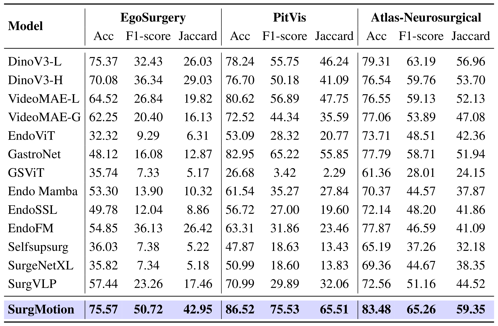{: w="538" }
_Table 3. 개복, 경비 내시경, 신경외과 수술 단계 인식_

- **복강경 밖 단계 인식**
  - **목적**: 시점과 조명이 전혀 다른 수술 환경으로 시간 이해가 전이되는지 확인
  - Table 3에서 1인칭 개복 수술(EgoSurgery), 경비 뇌하수체 수술(PitVis), 두개 신경외과(Atlas-Neurosurgical) 모두 SurgMotion이 최고. 저자들은 EgoSurgery와 PitVis의 F1 개선을 초록의 대표 결과로 제시하며, 최고 수술 특화 모델 대비 개선이 가장 크다고 강조

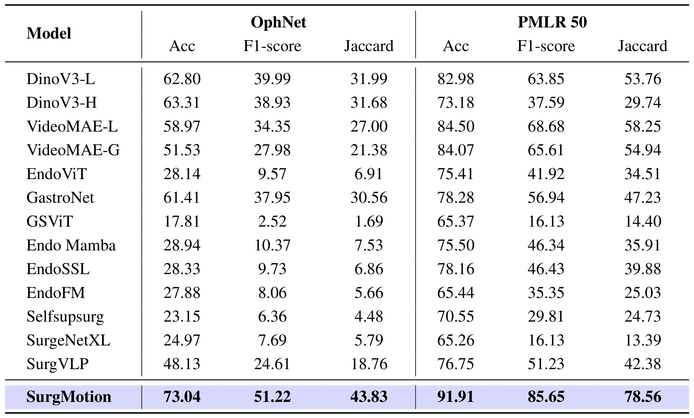{: w="586" }
_Table 4. 안과 수술과 복강경 간 절제 단계 인식_

- **안과와 간 절제 단계 인식**
  - **목적**: 단계 수가 많은 안과 수술과 간 절제 수술에서의 시간 이해 확인
  - Table 4에서 단계 수가 많은 OphNet과 PmLR50 모두 SurgMotion이 최고. OphNet에서는 정확도와 F1 모두 DINOv3-L을 크게 넘고, PmLR50에서는 차순위 VideoMAE-L 대비 F1의 개선이 특히 크다는 결과

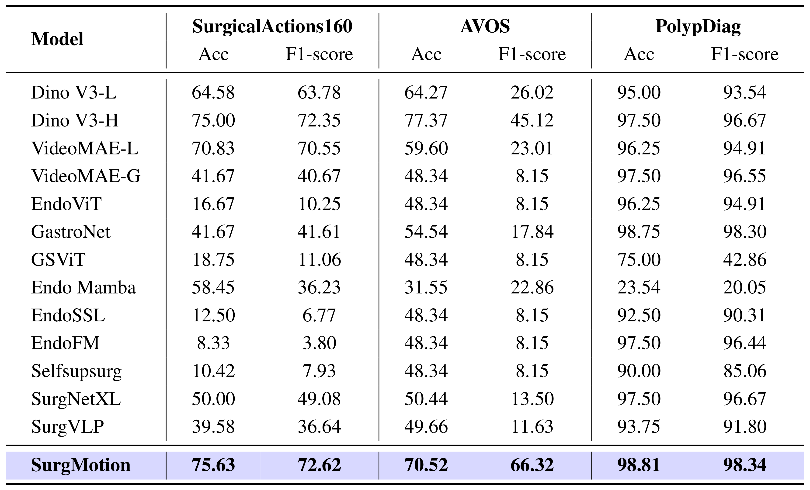{: w="583" }
_Table 5. 복강경, 개복, 대장내시경 동작 인식_

- **짧은 동작 인식**
  - **목적**: 단계보다 짧은 시간 규모의 동작 인식 성능 확인
  - Table 5에서 SurgicalActions160은 DINOv3-H와 비슷한 수준이면서 수술 특화 모델들을 크게 앞서고, AVOS에서는 F1이 모든 기준 모델보다 크게 높으며, PolypDiag에서는 강한 GastroNet을 근소하게 넘는다는 결과. 저자들은 세 과제 전체를 "경쟁력 있거나 우월한" 성능으로 요약

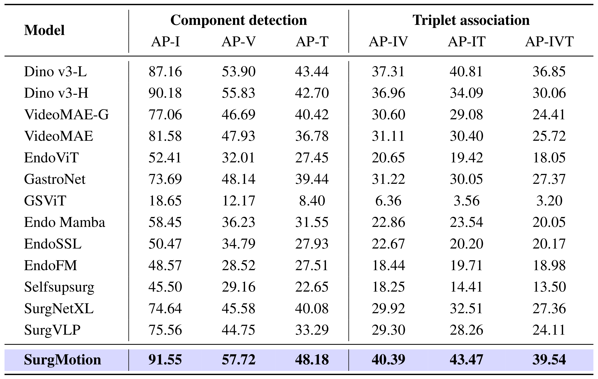{: w="556" }
_Table 6. CholecT50 action triplet 인식_

- **Action triplet 인식**
  - **목적**: 도구, 동작, 대상을 동시에 인식하고 그 조합을 연결하는 능력 확인
  - Table 6에서 도구, 동작, 대상의 개별 AP와 IV, IT, IVT 조합 AP 모두 SurgMotion이 최고. 저자들은 동작(verb) 인식이 일관되게 오른 것을 영상 기반 사전학습이 미세한 수술 동작을 구분하는 움직임 동역학을 포착한다는 근거로 해석

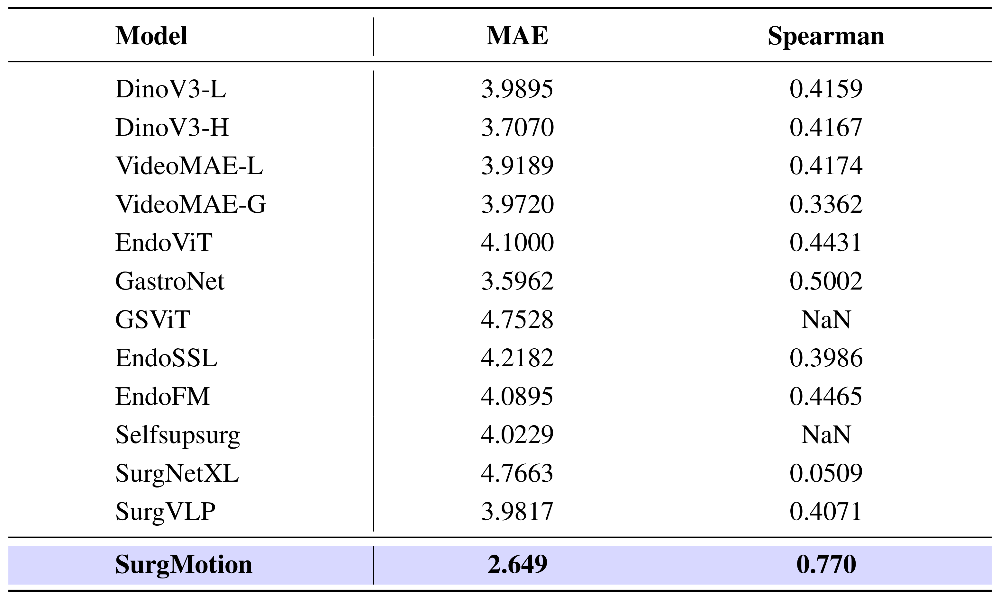{: w="522" }
_Table 7. JIGSAWS 술기 평가_

- **술기 평가**
  - **목적**: 로봇 수술 훈련 과제에서 전체 술기 점수를 예측할 수 있는지 확인
  - Table 7에서 SurgMotion이 MAE는 가장 낮고 Spearman 상관은 가장 높으며, 차순위 GastroNet과의 차이도 크다는 결과. 저자들은 표현이 어떤 동작을 했는지뿐 아니라 그 동작의 질과 유창함까지 담는다고 해석

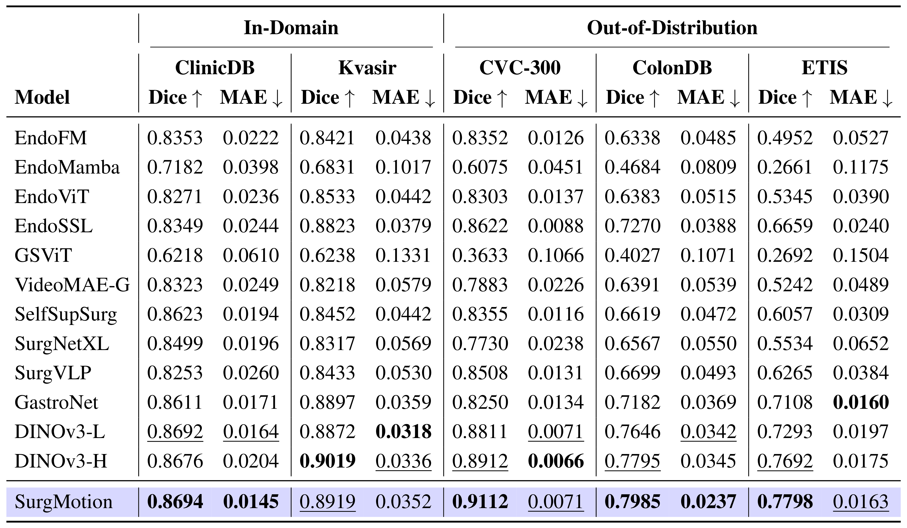{: w="619" }
_Table 8. 대장내시경 용종 분할_

- **용종 분할과 분포 이동**
  - **목적**: 영상 수준 사전학습이 픽셀 단위 밀집 예측으로 전이되는지, 분포 밖 데이터에서도 유지되는지 확인
  - Table 8에서 분포 안(Kvasir, CVC-ClinicDB)은 최강 기준 모델과 비슷하고, 분포 밖(CVC-300, CVC-ColonDB, ETIS) 세 데이터셋의 Dice는 모두 최고라는 결과. 저자들은 이를 데이터셋 고유의 특징이 아니라 일반화 가능한 용종 형태 특징을 학습한 근거로 제시

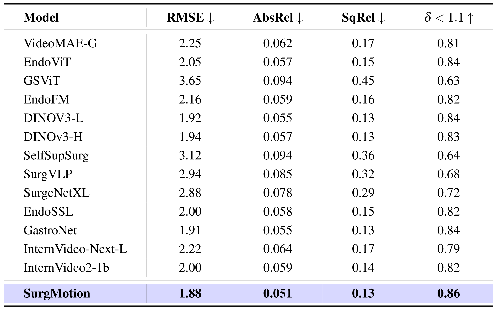{: w="533" }
_Table 9. C3VD 단안 깊이 추정_

- **단안 깊이 추정**
  - **목적**: 기하 예측을 명시적으로 학습하지 않은 표현이 3차원 구조를 담고 있는지 확인
  - Table 9에서 RMSE, AbsRel, δ<1.1이 모두 최고이며 InternVideo2 같은 범용 영상 모델도 앞선다는 결과. 저자들은 latent 예측 목표가 움직임 단서를 통해 3차원 공간 구조를 암묵적으로 학습한다고 해석

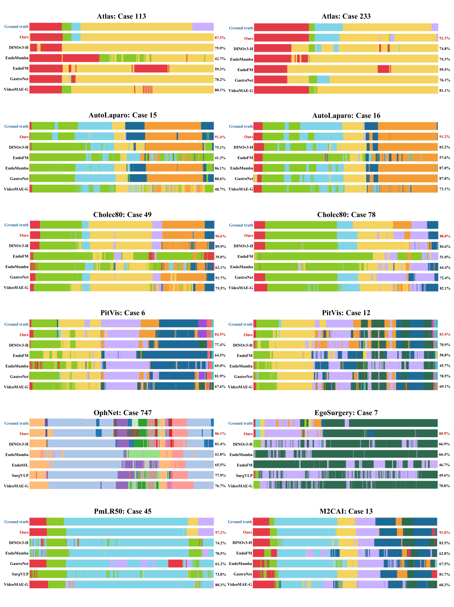
_Figure 3. 단계 예측 정성 비교_

- **단계 예측의 시간 일관성**
  - **목적**: 정량 지표 뒤에 있는 예측의 시간 구조를 사례 단위로 확인
  - Figure 3에서 SurgMotion의 단계 예측 막대가 정답의 경계를 따라가며 매끄러운 반면, 기준 모델들은 잦은 조각남과 단계 혼동을 보인다는 결과. 저자들은 시점 변화가 큰 EgoSurgery 사례와 Atlas 사례를 들어, 표현이 잡음 섞인 프레임 단위 예측이 아니라 일관된 단계 구조를 포착한다고 주장

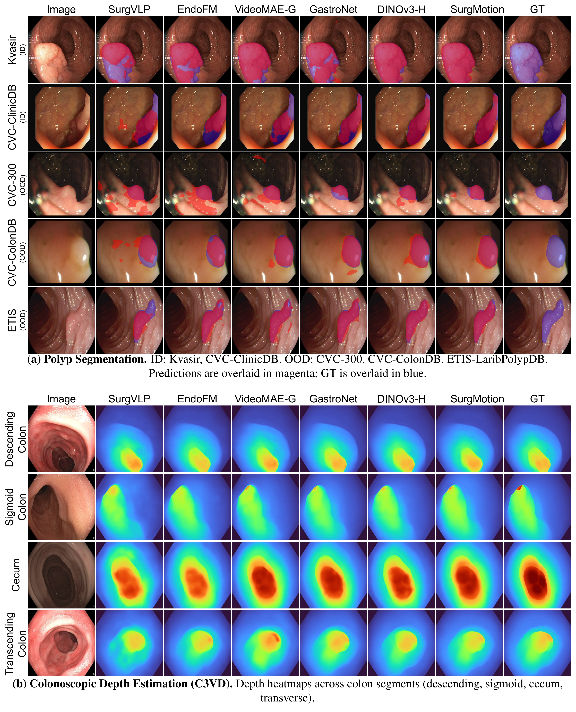{: w="683" }
_Figure 4. 용종 분할과 대장 깊이 추정 정성 비교_

- **밀집 예측의 정성 비교**
  - **목적**: 분할과 깊이 추정의 정량 우위가 예측 결과의 모양에서도 나타나는지 확인
  - Figure 4(a)에서 분포 밖 데이터셋의 기준 모델 마스크가 끊기거나 불완전한 반면 SurgMotion은 정답 윤곽에 더 가깝다는 결과. 저자들은 이를 Table 8의 분포 밖 개선을 뒷받침하는 시각적 증거로 제시
  - Figure 4(b)에서 SurgMotion의 깊이 지도가 대장 내강의 관 모양 기하를 매끄러운 원근 변화로 재현하고, 기준 모델은 조직 경계 근처에 잡음이 있다는 결과

## Limitations & Thoughts

- **세 손실의 효과를 확인하는 실험의 부재**
  - 이 논문에서 가장 과대평가되기 쉬운 주장은 성능 향상이 움직임 중심 latent 예측이라는 학습 목표에서 왔다는 것이다. 세 손실 중 하나를 빼거나 가중치를 바꾸는 ablation이 본문에도 부록에도 없고, 같은 데이터로 학습한 원래 V-JEPA(또는 V-JEPA 2)와의 비교도 없다. 비교 대상 13개는 모두 학습 목표, 데이터, 모델 크기가 동시에 다르므로, 표 전체가 보여 주는 것은 "SurgMotion이라는 묶음"이 낫다는 것까지다
  - 공식 저장소 README는 SurgMotion이 V-JEPA 2 위에 만들어졌고 ViT-L(300M)과 ViT-G(1B) 두 변형이 있다고 밝히지만, 논문은 인코더를 V-JEPA 2 가중치로 초기화했는지, 표의 결과가 어느 변형인지 적지 않는다. Figure 1(c)에서 SurgMotion은 1.01B로 표시되어 있어, 300M 이하인 수술 모델 다수와 크기 차이가 크다
  - 이 공백을 정확히 겨냥한 것이 이후의 [OmniRAS](/paper-review/posts/2608.31048/)다. OmniRAS는 목적 함수를 바꾸지 않고 V-JEPA 2.1을 수술 영상으로 이어서 학습한 뒤 원래 인코더와 짝지어 비교했는데, 고정 인코더 평가에서 수술 사전학습의 이득은 과제에 따라 엇갈렸다. SurgMotion의 모든 결과가 고정 인코더 평가라는 점을 생각하면, 범용 V-JEPA 2를 같은 probe로 평가한 행 하나가 있어야 세 손실의 기여를 말할 수 있다

- **사전학습 데이터와 평가 데이터의 중첩**
  - Table 1의 사전학습 출처에 Cholec80, M2CAI-2016, AutoLaparo, PitVis, OphNet, PmLR50, EgoSurgery, AVOS, JIGSAWS가 들어 있고, 이 아홉 개가 그대로 하류 평가 데이터셋이다. CholecT50도 Cholec80 영상의 상당수를 공유한다. 논문은 사전학습에서 평가 분할을 제외했는지 밝히지 않는다
  - 라벨을 쓰지 않는 자기지도 학습이라도, 평가 영상을 미리 본 인코더는 그 영상의 장면과 시간 구조에 맞춰진다. 기준 모델 대부분은 이 영상들을 보지 못했으므로, 이 비교는 "시술과 기관을 넘는 일반화"보다 "평가 분포를 포함한 사전학습"의 효과를 함께 잰다. OmniRAS가 perceptual hash와 사례 ID로 평가 영상을 사전 차단한 것과 대조적이다

- **표 수치의 일관성**
  - Table 6의 EndoMamba 행 여섯 값은 Table 5의 EndoMamba 행 여섯 값과 완전히 같다. 둘 중 하나는 다른 표의 값을 옮긴 것으로 보인다
  - Table 3의 EndoFM EgoSurgery F1·Jaccard(36.13, 26.42)는 Table 2의 EndoFM Cholec80 F1·Jaccard와 같다. 초록의 대표 수치인 "EgoSurgery +14.6% F1"이 바로 이 EndoFM 값을 기준으로 계산된 것이어서 확인이 필요하다
  - 같은 클래스 집합에서 Jaccard는 F1보다 클 수 없는데, Table 2의 EndoFM AutoLaparo(F1 35.77, Jaccard 47.84)와 Table 3의 SurgVLP PitVis(F1 29.89, Jaccard 32.06)는 이 관계를 어긴다
  - Table 5의 AVOS에서 VideoMAE-G, EndoViT, GSViT, EndoSSL, EndoFM, SelfSupSurg 여섯 모델이 정확도 48.34, F1 8.15로 똑같다. 한 클래스만 내놓는 퇴화한 probe로 보이며, 이 과제의 "모든 기준 모델 대비 큰 개선"은 절반이 학습에 실패한 기준선과의 비교다. 또 AVOS 정확도는 DINOv3-H(77.37)가 SurgMotion(70.52)보다 높다
  - 본문은 용종 분할에서 SurgMotion이 분포 밖 세 데이터셋 모두 MAE가 가장 낮다고 쓰지만, 표 자체가 CVC-300은 DINOv3-H(0.0066), ETIS는 GastroNet(0.0160)을 굵게 표시한다
  - Table 1의 시간을 더하면 3,707.72시간, 영상 수는 45,817개로 본문의 3,658시간, 45,757개와 다르다. Figure 1(a)의 뇌 22,288.7시간은 전체 합계를 넘고, 담낭절제술은 Figure 1(a)에서 20.5시간, Table 1에서 77.51시간이다. 초록의 "17개 벤치마크"도 본문에서 세면 19개(단계 인식 8, 동작 인식 3, triplet 1, 술기 1, 용종 분할 5, 깊이 1)다

- **평가 프로토콜과 차이의 크기**
  - probe 16개 중 최고 결과를 보고하는데, 선택에 쓴 검증 분할이 따로 있는지 밝히지 않는다. 시드 반복과 표준편차도 없다. 그런데 차이가 작은 비교가 적지 않다. 깊이 RMSE(1.88 대 GastroNet 1.91), CVC-ClinicDB Dice(0.8694 대 DINOv3-L 0.8692), SurgicalActions160 정확도(75.63 대 DINOv3-H 75.00)는 단일 실행으로 우열을 말하기 어려운 차이다
  - 본문의 개선 폭은 비교 대상을 고르는 방식이 일정하지 않다. Cholec80 Jaccard 개선은 DINOv3-L 대비(+8.35)로 쓰지만 Jaccard 차순위는 GastroNet(72.02)이고, triplet AP-I도 DINOv3-L 대비(+4.4)로 쓰지만 DINOv3-H(90.18)가 더 가깝다

- **방법 서술의 모호함**
  - 식 그대로라면 $$\mathcal{L}_{\text{motion}}$$은 가려진 튜브 중 상위 $K=3$개에만 걸린다. 224 해상도에서 튜브는 196개이고 마스킹 비율이 75~95%이므로 가려진 튜브는 147개 이상인데, 그중 3개만 예측 손실을 받는다는 뜻이 된다. 실제로는 모든 가려진 튜브에 L1을 걸고 상위 3개에 가중치를 더하는 구현일 가능성이 높지만 논문으로는 확인할 수 없다
  - 튜브를 "$T$개 프레임 전체에 걸친 하나의 공간 위치"로 정의해 클립당 토큰이 $N = \frac{H}{16}\cdot\frac{W}{16}$개라고 쓰는데, V-JEPA는 2프레임 단위 tubelet으로 시간 축에도 토큰을 나눈다. 64프레임 클립 전체가 공간 위치당 토큰 하나로 묶이는지는 불분명하다
  - 서론은 SFDR이 "쌍별 유사도의 분산 정규화"와 "채널 간 공분산 최소화" 두 수준이라고 하지만, 식에는 차원별 표준편차 hinge 하나만 있고 $\sigma_0$ 값도 없다. 이 hinge는 VICReg의 분산 항과 같은 형태다. README는 "optical flow로 안내되는 예측"을 말하지만 논문의 움직임 점수는 픽셀 차분이다

- **데이터 규모 주장의 성격**
  - Figure 1(c)는 서로 다른 구조, 목적 함수, 크기의 모델을 사전학습 데이터 시간 축에 늘어놓은 것이지, 같은 모델의 데이터만 바꾼 확장 실험이 아니다. 3,028시간으로 두 번째로 긴 EndoSSL의 단계 인식 F1이 낮은 것처럼 경향도 단조롭지 않다. 데이터 규모가 성능을 높인다는 결론을 이 그림 하나로 내리기는 어렵다

- **이 계보에서의 위치**
  - SurgMotion과 OmniRAS는 같은 질문에 반대 방향으로 답한다. SurgMotion은 목적 함수와 데이터를 동시에 바꾸고 결과 묶음을 보고하며, OmniRAS는 목적 함수를 고정하고 데이터만 바꿔 효과를 분리한다. 수술 JEPA 세계 모델의 인코더를 고를 때 SurgMotion의 표는 "어느 인코더를 쓸지"의 근거는 되지만 "움직임 가중치가 왜 필요한지"의 근거는 아직 되지 못한다
  - 움직임 가중치라는 아이디어 자체는 세계 모델과 잘 맞는다. 행동 조건 세계 모델이 맞혀야 하는 것은 도구가 조직에 닿아 생기는 변화이고, 정적 배경 예측에 용량을 덜 쓰는 표현이 유리할 수 있다. 다만 SurgMotion은 초당 1프레임으로 16초, 64초 클립을 학습하므로, 초당 수십 번 행동을 내는 로봇 제어 주기의 세계 모델에 쓰려면 시간 해상도가 맞는지 따로 확인해야 한다. 초당 4프레임 4초 클립을 쓰는 OmniRAS와 시간 규모가 크게 다르다

---

이 시리즈의 다른 글: [jepa-world-model](/paper-review/categories/jepa-world-model/)

> 원문: [arxiv.org/abs/2602.05638](https://arxiv.org/abs/2602.05638) · GitHub: [github.com/CAIR-HKISI/SurgMotion](https://github.com/CAIR-HKISI/SurgMotion) · 그림·표 출처: 원문 (CC BY 4.0)
